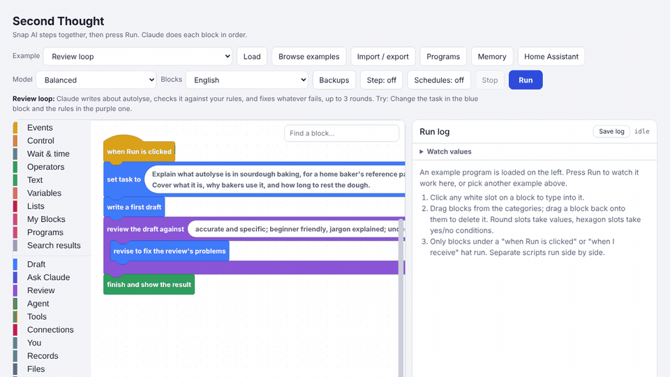
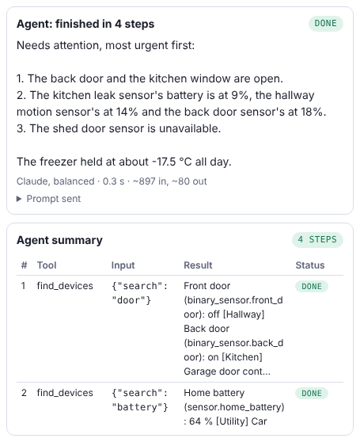
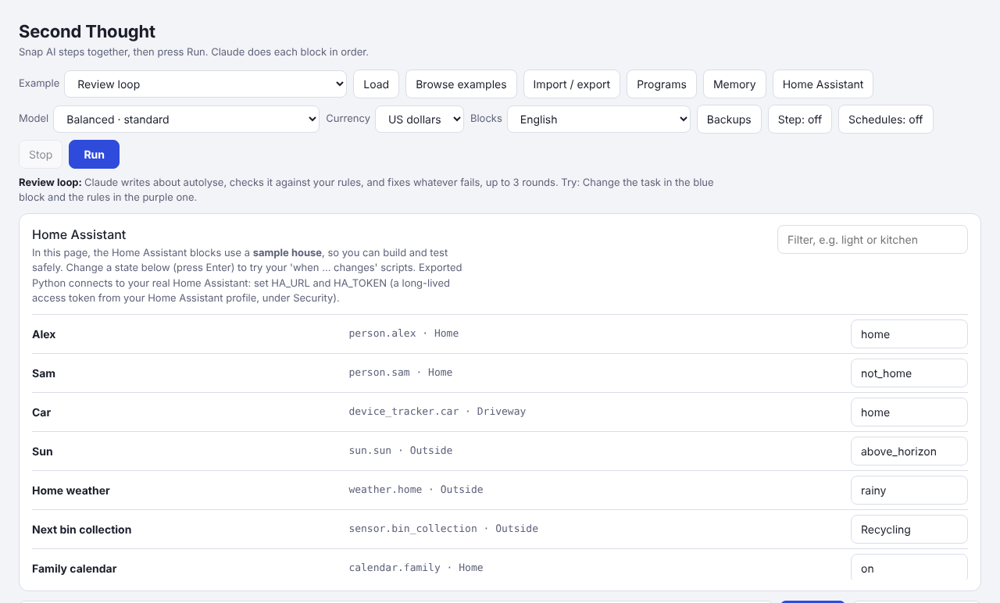
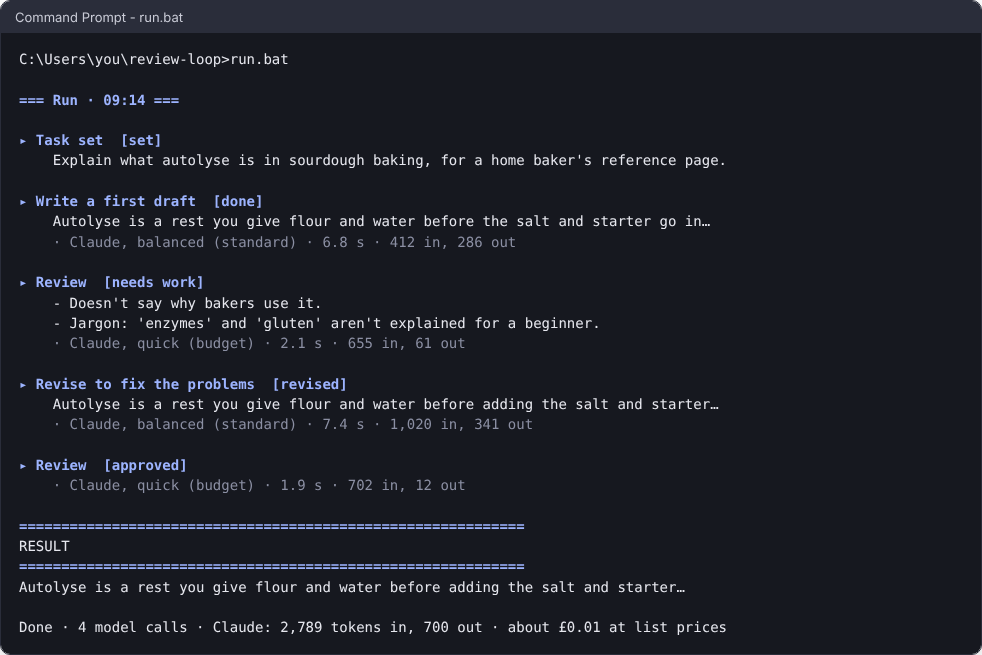
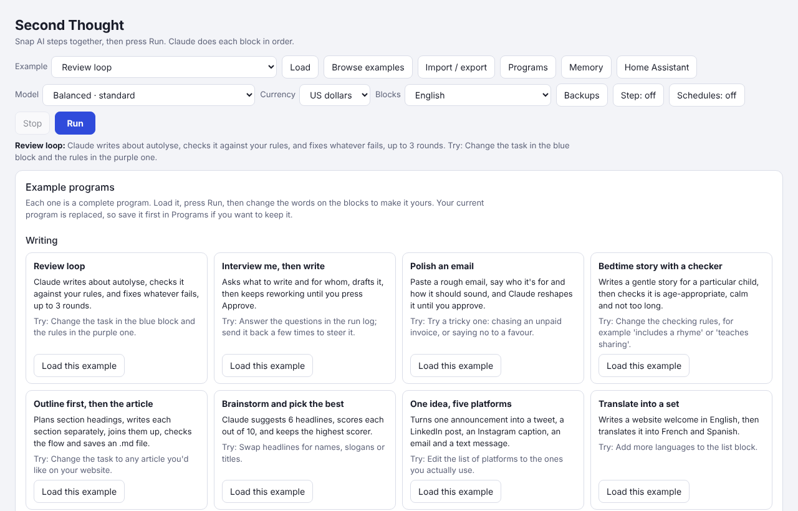
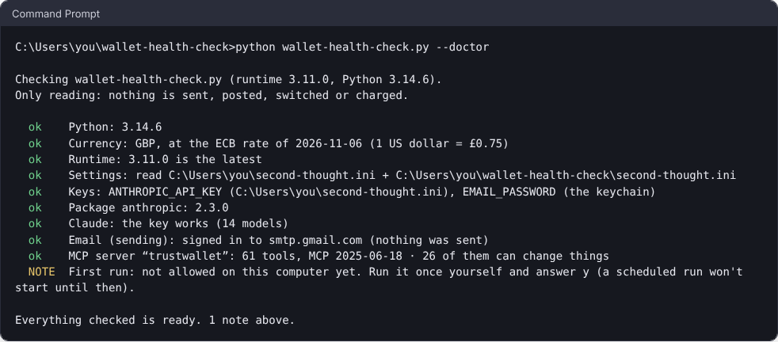

# Second Thought

**Scratch-style blocks for building AI workflows that check their own work.** Snap together steps like *draft*, *review against these rules*, *revise* and *use these tools*, press Run, and watch each block do its job. When a program does what you want, export it as a single Python file that runs on its own: on a schedule, from a webhook, in Telegram or Home Assistant. It works with Claude, Gemini, GPT, Llama on your own computer, and a dozen other models.

## Try it

1. **Open [Second Thought](https://claude.ai/artifact/XmNRmDbYLY3bo7o31nvdzN)** in claude.ai. There's nothing to install, and runs use your claude.ai account. There's also a copy at **[itsfja.github.io/second-thought](https://itsfja.github.io/second-thought/)**, updated with each release, which runs programs with your own API key for Claude or eleven other model services, or Llama on your own computer ([how](docs/using-the-page.md#using-the-page)). Each [release](https://github.com/itsfja/second-thought/releases/latest) also has **second-thought-offline.html**, the page as one file that works with no network.
2. **Pick an example and press Run.** There are over 150, from a simple review loop to agents that plan a bake or check on the house. Change the words in any block and run it again.
3. **Export it.** *Import / export → Save Python (.zip)*, unzip, put your API key in `second-thought.ini`, then run `run.bat` (Windows) or `sh run.sh` (Linux, Mac). [Running exported programs](docs/running.md) has the details.

New to all this? [**The picture book**](docs/ladybird-book.md) is a gentle, Ladybird-style introduction to what Second Thought is and why it checks its own work.

## What it can do

<table>
<tr>
<td width="50%" valign="top">

**Check its own work.** Write, review against rules you wrote down, revise, and go round again until it passes. If it runs out of tries it keeps the best attempt, not the last. [More](docs/using-the-page.md#what-a-program-can-do)

</td>
<td width="50%" valign="top">

**Agents.** Give a model a goal and tools (your house, your files, the web, a calculator, MCP servers) and it plans, acts and reports, with every step in the run log. Anything that changes the world asks you first. [More](docs/agent.md)

</td>
</tr>
<tr>
<td valign="top">

**Your home and your apps.** Home Assistant, Homey, MQTT, Telegram, Discord, Slack, email, calendars, feeds, GitHub. On the page they use sample data, so you can build safely. [More](docs/connections.md)

</td>
<td valign="top">

**One file you own.** Export a single Python file that runs on your computer, on a schedule, or on GitHub Actions, with `--doctor` to check everything's set up. [More](docs/running.md)

</td>
</tr>
<tr>
<td valign="top">

**Over 150 examples and a community gallery.** Writing, research, baking, the house, money, code. Load one, press Run, then make it yours. [More](docs/using-the-page.md#examples-and-the-gallery)

</td>
<td valign="top">

**MCP and money, carefully.** Use any MCP server's tools, GitHub's among them. Kraken and Trust Wallet tools that move money always ask first and never run unattended. [More](docs/mcp.md)

</td>
</tr>
</table>

It also speaks 21 other languages besides English, from Spanish and Japanese to Akkadian in cuneiform ([Languages](docs/using-the-page.md#languages)), and works with 15 model services, with backups if one is down ([Models](docs/settings.md#models)).

## Read more

| Page | What's in it |
|---|---|
| [Using the page](docs/using-the-page.md) | The blocks, what a program can do, the examples and gallery, saving, languages |
| [The agent](docs/agent.md) | Goals and tools, planning, what always asks first |
| [Connections](docs/connections.md) | Telegram, email, calendars, feeds, web requests, GitHub, Home Assistant, Homey |
| [MCP tools](docs/mcp.md) | Any MCP server, GitHub, Kraken, Trust Wallet, and your program as a tool |
| [Running exported programs](docs/running.md) | Exporting, schedules, GitHub Actions, approving, test cases, memory, `--doctor` and updates |
| [Settings and models](docs/settings.md) | Where settings come from, the run settings, models and backups |
| [SECURITY.md](SECURITY.md) | What a program can and can't do, and how to report a problem |
| [CONTRIBUTING.md](CONTRIBUTING.md) | How the code fits together, the repository layout, and the tests |
| [CHANGELOG.md](CHANGELOG.md) · [ROADMAP.md](ROADMAP.md) | What changed in each release, and what's next |

## Good to know

- Things a program remembers on the page are only visible to you.
- On the page, Claude can't look things up on the internet. An exported program can.
- Timed jobs on the page only work while the page is open. For jobs that run while you sleep, export to Python.
- Every answer has a length limit. If a model runs out of room part-way, the program asks it once to carry on from where it stopped and joins the two parts. If it's still too long, the run log says **Cut short**, and the result is marked best effort.
- The page can't see exactly how many tokens Claude used, so it estimates. Python knows the exact number.
- Some blocks need an answer in a particular shape, like a number or a yes or no. In Python, Claude is made to write exactly that shape. Most other models are asked to write in that shape too, or at least to write valid JSON; if one can't, the program remembers and stops asking. Every answer is still checked when it arrives, on the page as well. If an answer comes back malformed, the program sends it back once and says what was wrong. If it's still malformed, that step stops with a clear message, so put it inside **retry** if you'd like another go.
- On the page, your browser already asks before saving any file, so **ask me before saving files** only adds a question in Python.
- Some names inside the page still say `reflection-blocks`, Second Thought's original name. They stay the same so that old saved programs still work.

## Licence

[MIT](LICENSE). Contributions are welcome: [CONTRIBUTING.md](CONTRIBUTING.md) explains how.
