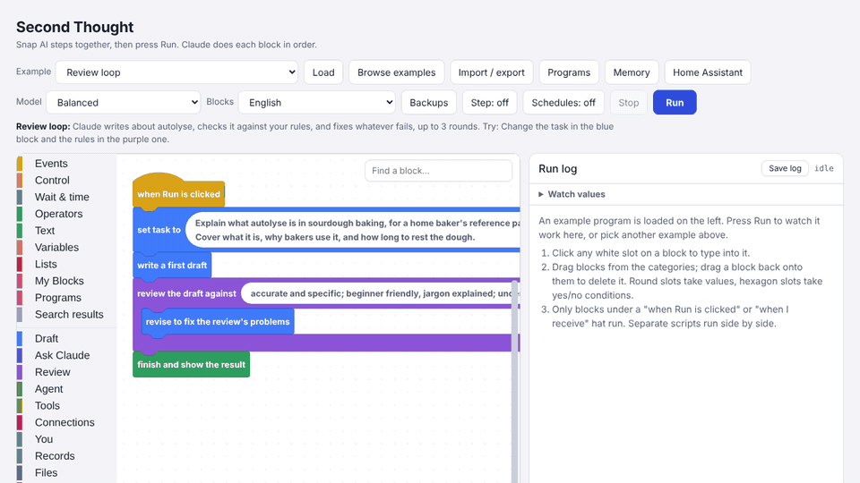

# Second Thought

[](https://github.com/itsfja/second-thought/actions/workflows/ci.yml)
[](CHANGELOG.md)
[](.github/workflows/ci.yml)
[](LICENSE)

**Scratch-style blocks for building AI workflows that check their own work.** Snap together steps like *draft*, *review against these rules*, *revise* and *use these tools*, press Run, and watch each block do its job. When a program does what you want, export it as a single Python file that runs on its own: on a schedule, from a webhook, in Telegram or Home Assistant. It works with Claude, Gemini, GPT, Llama on your own computer, and a dozen other models.



**Try it in three steps**

1. **Open [Second Thought](https://claude.ai/artifact/XmNRmDbYLY3bo7o31nvdzN)** in claude.ai. Nothing to install, and runs on the page use your claude.ai account.
2. **Pick an example and press Run.** There are over 150, from a simple review loop to agents that plan a bake or check on the house. Change the text in any block and run it again.
3. **Export it.** *Import / export → Save Python (.zip)*, unzip, put your API key in `second-thought.ini`, then run `run.bat` (Windows) or `sh run.sh` (Linux, Mac). [Exporting to Python](#exporting-to-python) has the details.

New to all this? [**The picture book**](docs/ladybird-book.md) is a gentle, Ladybird-style introduction to what Second Thought is and why it checks its own work.

**Contents:** [Using the page](#using-the-page) · [What a program can do](#what-a-program-can-do) · [The agent](#the-agent) · [Connections](#connections) · [Examples and the gallery](#examples-and-the-gallery) · [Saving programs](#saving-programs) · [Exporting to Python](#exporting-to-python) · [Models](#models) · [Home Assistant](#home-assistant) · [Homey](#homey) · [MCP tools](#mcp-tools) · [Languages](#languages) · [Versions and --doctor](#versions-and---doctor) · [Good to know](#good-to-know) · [Repository layout](#repository-layout) · [Development and tests](#development-and-tests)

---

## Using the page

Each block is one instruction, like *write a first draft*, *review the draft against …* or *revise to fix the review's problems*. Drag blocks from the categories on the left and click them together. Only blocks under a **when Run is clicked** or **when I receive** hat run, top to bottom; separate scripts run side by side. Click any white slot to type into it. Round slots take values, hexagon slots take yes/no conditions.

The blocks are colour-coded by job:

- **Yellow** starts things. **when Run is clicked** goes at the top.
- **Orange** repeats or chooses.
- **Blue** asks Claude to write.
- **Purple** asks Claude to check the writing.
- **Teal** asks *you* a question and waits for your answer.
- **Olive** makes an [agent](#the-agent), a helper that decides its own steps. Its tools are a darker olive, in their own **Tools** category.
- **Pink**, under **Connections**, talks to Telegram, email, your calendar and news feeds.
- **Green** shows the result.

There are more categories down the left side of the screen.

**Running.** Press **Run**. The **run log** on the right adds an entry as each block does its job, and a green box at the end shows the result. Under each step that asks a model something, a grey line says which model answered, how long it took and roughly how many tokens it used; click **Prompt sent** to see exactly what it was asked. Under the result is an estimate of the run's total tokens (on the page this is estimated from the length of the text; exported Python reports exact counts). **Save log** keeps every step, its timing and the result as a file. **Stop** stops everything at once.

**Backups.** The **Model** menu picks the main model. **Backups**, next to it, lists spare models: if the main one can't answer (its key is missing, or the service is down), the first backup does that step instead, and the run log says so.

---

## What a program can do

- Write, check, then try again until the writing passes. If it runs out of tries, it keeps the best attempt, not the last, and each check makes sure earlier problems haven't come back.
- **Save a checkpoint** when the draft is good, and **go back to the checkpoint** if later changes make it worse.
- Ask you questions and wait for your answer.
- Look at a picture you give it and describe it, or draw simple pictures.
- Read a document, such as a PDF or a Word file.
- Save its work as a file.
- **Remember** things for next time.
- Do several jobs at the same time.
- Wait until a time of day, then start a job by itself.
- Retry when something goes wrong.
- Stop itself before it uses too many tokens: put **limit this run to … tokens** near the top.
- Ask you first before it sends a message, says something out loud, saves a file or changes something at home: use **ask me before …**.
- Use one of your saved programs as a single block: **run program … with …**, from **Programs**.
- Use other models alongside Claude, for example Claude writes and Gemini reviews. See [Models](#models).

---

## The agent

Most programs do exactly what the blocks say, in order. An **agent** is different: you give it a **goal** and some **tools**, and Claude decides what to do next. It picks a tool, looks at what happened, and picks again. When the goal is met, it writes its answer into the draft.

The olive block **agent: work toward …** holds the tools, which have their own category, **Tools**, just below **Agent**. Drop in as many as you like:

- **ask me a question**, for things only you know.
- **remember and recall notes**, to keep what it learns for next time. It can also **search its notes**, so even among hundreds it finds the right one by its content, without knowing its exact name.
- **search the web and read pages**, for things that change. It can search, then read a source page in full. Reading pages only works in exported Python, and only public pages, never addresses on your own network.
- **work out sums**, so numbers are calculated exactly, not guessed: + − × ÷, powers, brackets and rounding, like `round(350 / 500 * 100, 1)`.
- **clock times and dates**, for the time now and for adding or taking away minutes, like 09:30 plus 270 minutes. Good for working backwards from when you want bread out of the oven.
- **read a file I choose**: the agent asks you for a PDF, a Word file or a text file and reads it.
- **check text against criteria**: a separate, strict reviewer checks the agent's work and lists the problems, so the agent can fix them before it finishes.
- **news feeds**, to read the latest from news sites and blogs (RSS or Atom).
- **search LinkedIn**, through the web search. LinkedIn doesn't let programs search it directly, so this only finds what LinkedIn shows everyone.
- **calendar**, to list your events and find free time.
- **email: search and read**, and **email: send**.
- **GitHub: projects and pull requests**, to find pull requests waiting for your review and read what they change, and **GitHub: comment**.
- **Telegram: search my messages** and **Telegram: send**.
- **Discord: search my channels** and **Discord: send**, and the same for **Slack**. They only read and post in the channels in your settings.
- **MQTT: read topics** and **MQTT: publish**, for sensors and switches that talk MQTT (like Zigbee2MQTT).
- **Home Assistant: look at devices**, including how a sensor changed over the last day, and **control devices**. Control devices asks you before every change, because something the agent reads could try to trick it. If you trust everything it reads, choose **control devices (no asking)**.
- **tool: My Block**, to turn one of your own My Blocks into a tool. Write a clear sentence about what it does, because that sentence is all the agent knows about it. **Ask me before each use** starts ticked, so you approve before your block runs. That matters if the block changes something. Untick it for blocks that only work something out, like a calculator.
  In **input types**, say what each input must be, like `flour grams: number; water grams: number`. The types are text, number, yes/no, list and any. The agent's input is checked before your block runs; if it's wrong, for example words where a number should be, the block doesn't run and the agent is told what to fix.

Tick **make a plan first** and the agent writes a short plan with its first step, then changes it if something surprises it. The plan shows in the run log, and costs nothing extra, because it travels with the steps.

Each step is one model call, so set how many steps it may take. If it runs out of steps, the draft holds whatever it found last. If a reply comes back unreadable, or it asks for the same tool with the same input twice in a row, the agent tells it and tries again; that uses a step. Three repeats in a row and the agent stops.

An agent only reads the words tools send back. It never follows instructions inside them, and it can't unlock a door without asking you. Tools that send or change something (email, Telegram, GitHub comments, MQTT publish, controlling devices) ask you before each use, because an email, a web page or a pull request can contain words written to trick the agent. Telegram has a **send (no asking)** choice for a bot that answers on its own.

When the agent finishes, the run log shows an **Agent summary**: one row per step, with the tool, what it sent, what came back, and how it went. You get it even if the run stops part-way. The block **agent's steps** gives the same as a list, for your program to check, save or have reviewed.

On the page, the feeds, GitHub, email, Telegram and the calendar use **sample** data, so you can try everything safely; nothing real is read or sent. Exported programs use your real accounts: see [Connections](#connections) for the settings.

There are 19 agent examples under **Agents** in **Browse examples**. **Agent: plan my bake** asks and remembers. **Agent with your own tool** uses a My Block. **Agent: bake timetable** works backwards with the clock. **Agent: scale a recipe** does every sum with the sums tool. **Agent: write, check, improve** fixes its work until a reviewer passes it. **Agent: check my recipe file** reads a file you choose. **Agent: research with sources** searches and reads its sources. **Agent: house check-up** and **Agent: bedtime round** look after a Home Assistant house, and the bedtime round asks before switching anything off. **Agent: news round-up** reads your feeds and skips what it showed you last time. **Agent: trip planner** checks your calendar and builds a plan with times and a budget. **Agent: pull requests for me** and **Agent: review and comment on a pull request** work with GitHub. **Agent: inbox triage** sorts your email and drafts replies. **Agent: plan my week** fits baking around your calendar. **Telegram bot that answers** replies to messages you send your bot. **Agent: find people on LinkedIn** searches LinkedIn's public pages.

---

## Connections

The pink **Connections** blocks work without an agent too.

**Listeners** start a script when something arrives:

- **when a Telegram message arrives**, for messages to your bot.
- **when a Discord message arrives** and **when a Slack message arrives**, for messages in your channels, checked every 10 seconds. Only the channels in `DISCORD_CHANNEL_ID` or `SLACK_CHANNEL_ID` count, because anyone in a server or workspace can post; the bot's own messages never count. Discord needs the bot's *Message Content Intent* turned on.
- **when an MQTT message arrives on …**, for a sensor or switch. `+` stands for one level of the topic and `#` for everything below, like `zigbee2mqtt/#`.
- **when a web request arrives at /…**, for Home Assistant automations, IFTTT, or a shortcut on your phone. Every request must carry your `WEBHOOK_SECRET`, or it's refused. Until you set one, the program doesn't listen for web requests at all. By default only the same computer can reach it; see `WEBHOOK_HOST` below to let other devices in.
- **when an email arrives containing …**, checked every 2 minutes.
- **when there's something new in feed …**, checked every 15 minutes.
- **when a file appears in folder …**, for scans, downloads or recipes you drop in. It reads the words in PDFs, Word files and text files.
- **when a pull request asks for my review**, checked every 5 minutes.
- **when a calendar event starts in … minutes**, for reminders.
- **when the web page … changes**, for a price, a stock notice, opening times or the council's bin page. Fill in **only the part containing …** (like `Price`) to watch just the lines with those words and the two lines after each, so adverts and visitor counters elsewhere on the page don't count. It checks every 60 minutes unless you say otherwise. The first check only remembers the page. What changed is in `changed`, with `before` and `after`. The last copy of each page is kept in `watched-pages.json`, next to the program, so a restart doesn't count every page as changed. Pages that need a browser to show their words can't be watched.

**what arrived** gives what started the script. Every listener gives `text`, which sums it up; each block's tooltip lists its other fields, like `subject` for an email or `topic` for MQTT. **Telegram message** gives a Telegram message's words, sender or chat. On the page, right-click a listener and choose **Run this script** to try it with a sample of what arrives. Listeners only listen while the exported program runs on schedule.

**Other blocks:**

- **latest MQTT message on …** reads a topic, and **publish MQTT … to topic …** sends one. With **ask me before any smart home action**, publishing asks you first.
- **send Telegram message**, **send Discord message**, **send Slack message** and **send email** send something. The Discord and Slack ones reply in the channel a message came from, or post in your first channel. With **ask me before sending messages and announcements**, they ask you first.
- **news from feed** gives a list of the latest items. Leave it empty for your own feeds.
- **calendar for the next … days** gives a list of your events.

Try **Morning briefing on Telegram** and **Email me a news digest** under Automation, and the listener examples: **Proofer too warm? (MQTT)**, **When the bread is done (web request)**, **When the flour shop emails**, **Tell me when a feed posts something useful**, **Convert recipes dropped in a folder**, **When someone asks for my review (GitHub)** and **A reminder before each event**. Press Run to try each with something you type. Under Agents, **Agent: check the sensors (MQTT)** looks over your MQTT devices.

**Settings.** An exported program's `second-thought.ini` asks only for what it uses:

- **GitHub:** `GITHUB_TOKEN`, from github.com/settings/tokens. Read access is enough to look; to comment, it also needs write access to pull requests.
- **Telegram:** in Telegram, message **@BotFather** and send `/newbot`. It gives you `TELEGRAM_BOT_TOKEN`. Then message your bot and run the program: it tells you your chat number for `TELEGRAM_CHAT_ID`. Anyone can message a bot, so it only listens to, and searches, the chats you list there. A bot only sees messages sent to it, so it can't search your other chats.
- **Email:** `EMAIL_ADDRESS` and an **app password**, not your normal password (in Gmail, it's in your Google account under Security). Gmail, iCloud, Yahoo and Fastmail find their own mail servers. For anything else, fill in `EMAIL_IMAP_HOST` and `EMAIL_SMTP_HOST`.
- **Calendar:** `CALENDAR_URL`, your calendar's private iCal address. In Google Calendar it's under Settings, your calendar, **Secret address in iCal format**. It can read your calendar, but not add to it.
- **News feeds:** `feeds = ` and the feed addresses, separated by spaces.
- **MQTT:** `MQTT_HOST`, your broker's address (for Mosquitto in Home Assistant, that's your Home Assistant), plus `MQTT_USERNAME` and `MQTT_PASSWORD` if it needs them. `MQTT_TLS = yes` makes it encrypted. It needs the paho-mqtt library, which run.bat and run.sh install.
- **Web requests:** `WEBHOOK_SECRET`, a long password, and `WEBHOOK_PORT` if 8765 is taken. Call `http://127.0.0.1:8765/<address>?key=<your secret>` from the same computer, or put the secret in an `X-Second-Thought-Key` header. The program only listens on this computer unless you add `WEBHOOK_HOST = 0.0.0.0`, which lets Home Assistant on another machine, IFTTT or your phone reach it at `http://<this computer>:8765/…`.

The agent only reads **public** web pages and feeds, never addresses on your own network, in case something it reads tries to steer it there. Your own feeds and calendar address are fine wherever they are. To let the agent read pages on your own network, add `local_pages = yes`.

To keep listening all the time, run the program with **run-on-schedule** (see [Running on a schedule](#running-on-a-schedule)). Things that arrived while it was off don't start the script: Telegram messages are kept for searching, and the email, feed, GitHub and folder listeners start from what's new after the program starts.

---

## Examples and the gallery

Choose an example from **Example** and press **Load**, or press **Browse examples** to see them all with a sentence about each and an idea for something to change. There are over 150, grouped into Writing, Research, Design, Learning, Work, Home and baking, Agents, Homey, Code and data, Automation, and ten groups of Home Assistant examples. **Review loop** is a good first one. You can't break anything: if you get in a muddle, load the example again.

The last group, **Community**, holds programs other people made and shared. Each says who shared it and what it can do: whether it only talks to a model, or can also send messages, keep notes or control things. The page works that out from the blocks, so it's always accurate. To share your own, see [`gallery/README.md`](gallery/README.md).

---

## Saving programs

Press **Programs**, type a name and press **Save**. Open the same panel and press **Open** to get it back. To keep a copy as a file, use **Import / export**.

A saved program can be a block, too. Put **run program "my program" with …** inside another program. The saved program runs, then hands back its result. Inside it, **message value** holds whatever you gave it. It has its own draft and its own result, so it can't interfere with yours.

There are two rules. A program can't run itself, because that would never end. And a program that uses **broadcast** blocks can't be used this way; run it on its own instead.

---

## Exporting to Python

An exported program runs on any computer by itself, with the page closed. It talks to the model services directly, so it needs an API key, and calls are billed by the service, separately from claude.ai.

Press **Import / export**, then **Save Python (.zip)**, and unzip it into a folder of its own:

| File | What it is |
|---|---|
| `my-program.py` | The program, with the runtime built in. |
| `second-thought.ini` | Settings, including keys. It lists only what *this* program needs. |
| `run.bat` | Windows: double-click to run. |
| `run.sh` | Linux or Mac: the same job as `run.bat`. |
| `requirements.txt` | The packages it needs. `run.bat` and `run.sh` install them for you. |

Open `second-thought.ini` in any text editor, put each key after its `=` sign, and save:

```
[keys]
ANTHROPIC_API_KEY = sk-ant-your-key-here
```

Keep this file private: it holds your keys.

**On Windows:** install Python from python.org (tick **Add python.exe to PATH**), then double-click `run.bat`. The first time, it installs what the program needs.

**On Linux or a Mac:** in a terminal in the folder, run:

```
sh run.sh
```

The first time, it makes a private `.venv` next to the program and installs into that, so nothing is installed for the whole computer. (On Debian or Ubuntu, if it can't set up Python, run `sudo apt install python3-venv` first.)

### Running on a schedule

If a program has timed jobs or listeners, the zip also has `run-on-schedule.bat` and `run-on-schedule.sh`. These keep running, so the jobs start by themselves, and if the program stops with a problem they start it again 30 seconds later.

To start it automatically:

- **Windows:** double-click `install-startup.bat` once. The program then starts in a small window each time you log in. To undo it, press Windows+R, type `shell:startup`, and delete "Second Thought - my-program".
- **Linux or a Mac:** run `sh install-service.sh` once. On Linux it starts whenever the computer starts (it asks for your password to set this up); on a Mac, whenever you log in. It tells you how to watch what the program is doing, and how to turn it off.

### Approving what a program can do

A program that does real things (sends email or messages, switches lights, posts on GitHub) asks you before it runs the first time:

```
This program can:
  - send email
  - read your calendars
It sends what it reads and writes to Claude.

Approve? [y/n] >
```

It remembers your answer until the program changes; a changed program might do different things, so it asks again. The same list is written at the top of the program, and the page shows it when you import one.

A scheduled program, with nobody there to answer, won't start until you've approved it once, so run it yourself first. If you're sure, and the computer is unattended, put `approve = no` in `second-thought.ini`.

If a program has an **ask me before** block, Python asks in the terminal and waits for `y` or `n`. With nobody there to answer, it says no and carries on.

### Run settings

The ini file has a `[run]` section. Remove the `;` from the start of a line to switch it on:

```
[run]
budget = 50000
save_log = yes
```

- `budget` stops each run before a model call once it has used that many tokens. In Python the count is exact, because every service reports its usage. A **limit this run** block wins over this line.
- `stream` shows the model writing as it goes, on one line that counts the characters. Normally this only happens when you run the program in a terminal yourself.
- `resume` is for runs that stop part-way, for example because the internet dropped or you pressed Ctrl+C. The program keeps a note of each finished step, and next time it can pick up where it stopped: model answers, your answers and messages already sent are reused, not asked or sent again. In a terminal it asks you first; set `resume = yes` or `resume = no` for unattended programs. If you change the program, it starts afresh.
- `max_seconds` stops any run that takes longer than that, whatever it's doing. `call_timeout` gives up on a single model call after that many seconds (300 by default; 0 means no timeout). If one of these is mistyped, the program stops straight away and says which setting is wrong.
- `save_log` keeps a log of every run in a `logs` folder next to the program. Each step records which model answered, how long it took and the exact tokens, with the prompts under **Prompt sent**.

Services rename their models from time to time. To use a different model without editing the program, add `MODEL_` and the tier's name in capitals, like `MODEL_OPENAI_DEFAULT = gpt-6.2-sol` or `MODEL_QUICK = claude-haiku-4-5-20251001`. `second-thought.example.ini` shows the pattern.

### Memory and shared files

Memories saved "forever" live in `memory.json`, next to the program. Two programs can share one memory file (`RB_MEMORY_FILE`): they take turns to save, so neither loses the other's changes, and a save is never left half-written if a program stops part-way. Two programs using the same Telegram bot share `telegram-messages.json` the same way, and a message is only handled once.

### Where settings come from

Everything in `second-thought.ini` can also be set as an environment variable with the same name; an environment variable wins over the file.

[`second-thought.example.ini`](second-thought.example.ini) lists every setting a program understands, with a note on each: keys for every model service, models and backups, run settings, Home Assistant, Homey, MQTT, Telegram, email, calendar, GitHub, web requests and feeds. Copy it to `second-thought.ini` and fill in what you use. A program looks for `second-thought.ini` next to itself first, then in the folder you run it from, then in your home folder, so one copy in your home folder can serve every program you export.

---

## Models

On the page, Claude does every job; blocks that name another model are answered by Claude instead, and the run log says so. Exported programs talk to each service directly. Each needs its own key, from its own company:

| Model | Made by | Runs in | Setting |
|---|---|---|---|
| **Claude** | Anthropic | America | `ANTHROPIC_API_KEY` |
| **Gemini** | Google | America | `GEMINI_API_KEY` |
| **GPT** | OpenAI | America | `OPENAI_API_KEY` |
| **Grok** | xAI | America | `XAI_API_KEY` |
| **DeepSeek** | DeepSeek | China | `DEEPSEEK_API_KEY` |
| **Mistral** | Mistral AI | France | `MISTRAL_API_KEY` |
| **Qwen** | Alibaba | Singapore, for people outside China | `DASHSCOPE_API_KEY` |
| **Kimi** | Moonshot AI | China | `MOONSHOT_API_KEY` |
| **Perplexity** | Perplexity | America | `PERPLEXITY_API_KEY` |
| **Hugging Face** | many open models | all over the world | `HF_TOKEN` |
| **Groq** | Groq | America | `GROQ_API_KEY` |
| **GLM** | Z.ai | China | `ZAI_API_KEY` |
| **MiniMax** | MiniMax | China | `MINIMAX_API_KEY` |
| **OpenRouter** | many companies, through one key | wherever each model runs | `OPENROUTER_API_KEY` |
| **Llama** | Meta, via Ollama | your own computer | `LLAMA_BASE_URL`, plus `LLAMA_API_KEY` if your server needs one |

Some notes:

- **Llama** runs on your own computer, so nothing you ask it leaves the house. Install [Ollama](https://ollama.com) and download a model with `ollama pull llama3.2-vision:11b`. If Ollama runs on another computer, set `LLAMA_BASE_URL = http://that-computer:11434/v1`.
- **GPT:** a ChatGPT subscription isn't an API key. You need a key from OpenAI's developer site.
- **DeepSeek** is very cheap. It runs on DeepSeek's own servers in China, so keep it for things that aren't private.
- **Perplexity** searches the web for every question and lists the pages it read at the end of its answer. That makes it good for things that change, like prices and opening times. It can't look at photos.
- **Hugging Face** hosts a huge library of open models. Second Thought starts you on Google's Gemma, but you can choose almost any model in the library.
- **Groq** (with a q, not to be confused with Grok) is very fast, and good for jobs with lots of small steps.
- **OpenRouter** reaches hundreds of models from many companies with one key. Choose **OpenRouter, auto-pick** and it chooses a model for each job, or use **with OpenRouter model** and type the name of any model from openrouter.ai/models.

---

## Home Assistant

Second Thought talks to [Home Assistant](https://www.home-assistant.io), with its own blue blocks:

- Read state: "Is the back door open?"
- Take a camera snapshot, so a model can say who is at the door.
- Turn a light off, or send a notification to a phone.
- A yellow block starts a script when something changes, like the doorbell ringing.
- Another starts a script the moment Home Assistant fires an **event**, like a button on a remote.

On the page, these blocks use a **sample house**, so you can try everything safely. Press **Home Assistant** to see it, change something (the doorbell, say), and watch your program react. There are more than 60 Home Assistant examples in **Browse examples**.

**Safety rule:** Second Thought never unlocks a door, opens the garage or switches off the alarm without asking you first.

**Using your real Home Assistant.** Export the program and unzip it on a computer on the same network. Make a long-lived access token in Home Assistant (your profile, then the Security tab), and put it in `second-thought.ini`:

```
[home assistant]
HA_URL = http://homeassistant.local:8123
HA_TOKEN = your-long-lived-token
```

Then run `run-on-schedule.bat` (Windows) or `sh run-on-schedule.sh` (Linux or Mac). On an always-on Linux computer, `sh install-service.sh` keeps it running for good. A small always-on virtual machine or container is a good home for it.

`--schedule` keeps it running, so timed jobs and "when it changes" scripts start by themselves. **when Home Assistant event … happens with …** listens on Home Assistant's WebSocket, using the same `HA_URL` and `HA_TOKEN`, so it reacts at once instead of polling. Use it for remote and button presses (`zha_event`, `deconz_event`, `hue_event`), `automation_triggered`, phone notification actions or your own events. Type `anything` for every event. The second box is optional words the event's data must contain, like the remote's name. **what arrived** gives `event_type`, `entity`, `data`, `time`, `text`, and each field of the event's data, like `command`. *Developer tools → Events* in Home Assistant shows what your devices send.

## Homey

Second Thought also talks to **Homey Pro**, with its own green blocks under **Homey**:

- **when Homey device … … changes** starts a script when a device's value changes, like the washing machine's power dropping. **what arrived** says which device, what changed, and from what to what.
- **… of Homey device …** reads one value, like `measure_temperature` of the Proofing box.
- **Homey devices matching …** lists devices and everything they report.
- **set Homey device … … to …** switches something, like `onoff` to `off` or `dim` to `0.5`.
- **run Homey flow …** starts one of your flows. A flow can do anything your Homey can, like sending a Homey notification.
- **Homey variable …** and **set Homey variable … to …** read and change your Logic variables, so your flows can use them.

There are agent tools too, under **Tools**: **Homey: look at devices, flows and variables**, and **Homey: control devices and start flows**, which asks you before each change. On the page these blocks use a **sample Homey home**; try the examples under **Homey** in **Browse examples**. The same safety rule applies: unlocking, opening the garage and switching off the alarm always ask you first.

**Using your real Homey.** In the Homey Web App (my.homey.app), open Settings, then API Keys, and make a new key with only the permissions the program needs: view devices, control devices, view and start flows, and view and edit Logic. Put it in `second-thought.ini` with your Homey's address:

```
[homey]
HOMEY_URL = http://homey-XXXXXXX.local
HOMEY_API_KEY = your-api-key
```

The address is in the Homey app under Settings, General. The computer running the program must be on the same network. API keys work with Homey Pro (2023 and later) and Homey Pro mini.

**Homey Self-Hosted Server** serves the same API on port **4859**, so use the address of the computer it runs on, with `:4859` on the end:

```
HOMEY_URL = http://192.168.1.20:4859
```

Make the API key in the Homey Web App the same way. A **Homey Bridge** connected to a Self-Hosted Server needs nothing of its own: its devices show up through the server. To check it all works, run `python tools/smoke_test.py homey`. It only reads, so nothing is switched.

---

## MCP tools

The agent can borrow tools from [MCP](https://modelcontextprotocol.io) servers: there are MCP servers for files, GitHub, databases, calendars and hundreds of other jobs. To give one to your agent, put this block inside it:

```
tools from MCP server  files   (asks me before tools that change things)
```

Then tell the exported program where the server is, in `second-thought.ini`. A server that starts on your computer:

```
MCP_FILES = npx -y @modelcontextprotocol/server-filesystem /home/me/recipes
```

A server at an address:

```
MCP_TRACKER = https://mcp.example.com/mcp
MCP_TRACKER_TOKEN = your-token
```

The name in the block (`files`) and the name in the settings (`MCP_FILES`) must match.

When the agent runs, it asks the server which tools it has and uses them like its own. Each tool says whether it only looks at things or can change them; the agent asks you before using one that changes things, unless you choose **(no asking)**. Choose **(asks me before every tool)** to be asked about all of them.

MCP servers only work in exported programs. On the page, the agent works without them, and the run log says so.

---

## Languages

Choose a language from **Blocks** at the top of the page. The page remembers your choice; if you've never chosen, it uses your browser's language when it can. Changing language only changes the words you see: a program built in Spanish opens the same in English, and exports the same Python.

The page speaks English, Spanish (Español), French (Français), German (Deutsch), Dutch (Nederlands), Italian (Italiano), Portuguese (Português), Simplified Chinese (中文), Japanese (日本語), Greek (Ελληνικά), Hebrew (עברית, with the whole page mirrored right to left), Jewish Babylonian Aramaic (ארמית, also right to left), Latin (Latina), Old English (Ænglisc), Middle English (Englisch), Koine Greek (Κοινή), Old Norse (Norrœnt mál), Sanskrit (संस्कृतम्), Akkadian in cuneiform (𒀝𒅗𒁺𒌝, written in transliteration by exported programs) and Mycenaean Greek in Linear B (𐀀𐀏𐀊𐀺, written in transcription by exported programs). The run log, the page's messages and the examples are translated too. Programs shared in the Community gallery keep their authors' words. A Python program you export while the page is in another language prints in that language too; `language = en` in its `second-thought.ini` switches it back to English.

**Adding a language.** Each language is one file in [`i18n/`](i18n), like `i18n/es.json`. It holds every block's words, help text and choices, the category names, the page's own words (under `page`, each English text with its translation), each example's title, description and tip (under `examples`), the words already typed into the palette's blocks (under `starters`), and what exported programs print (under `python`). Copy a file, translate the words (never the choice values, the `%1` markers or the `{name}` markers), and run `python tools/sync.py`. The tests tell you anything you missed.

---

## Versions and --doctor

Every exported program carries its own copy of the runtime, with a version number. To see which one a program has:

```
python my-program.py --version
```

To check a program has everything it needs before you rely on it:

```
python my-program.py --doctor
```

It checks each thing the program uses (keys, packages, Home Assistant, email, Telegram, MCP servers and the rest) and says **ok** for each that works, or **FAIL** with what to fix. It only looks: nothing is sent, posted or switched, and it uses no model tokens.

A program doesn't update itself. To give it a newer runtime, import it on the page and export it again; the page tells you when a program you import has a different runtime. [`CHANGELOG.md`](CHANGELOG.md) says what changed in each version.

---

## Good to know

- Things a program remembers on the page are only visible to you.
- On the page, Claude can't look things up on the internet. An exported program can.
- Timed jobs on the page only work while the page is open. For jobs that run while you sleep, export to Python.
- Every answer has a length limit. If a model runs out of room part-way, the program asks it once to carry on from where it stopped and joins the two parts. If it's still too long, the run log says **Cut short**, and the result is marked best effort.
- The page can't see exactly how many tokens Claude used, so it estimates. Python knows the exact number.
- Some blocks need an answer in a particular shape, like a number or a yes or no. In Python, Claude is made to write exactly that shape. Most other models are asked to write in that shape too, or at least to write valid JSON; if one can't, the program remembers and stops asking. Every answer is still checked when it arrives, on the page as well. If an answer comes back malformed, the program sends it back once and says what was wrong. If it's still malformed, that step stops with a clear message, so put it inside **retry** if you'd like another go.
- On the page, your browser already asks before saving any file, so **ask me before saving files** only adds a question in Python.
- Some names inside the page still say `reflection-blocks`, Second Thought's original name. They stay the same so that old saved programs still work.

---

## Repository layout

| Path | What it is |
|---|---|
| `second-thought.html` | The page itself. |
| `python/second_thought/` | The runtime that comes with every exported program, as a package of eight modules (below). |
| `python/runtime.py` | The same runtime joined into one file, which every exported program gets a copy of. `tools/sync.py` builds it, so don't edit it by hand. |
| `prompts/convert-guide.txt` | The instructions Claude reads when it turns Python back into blocks. |
| `ha/sample-house.json` | The sample house the Home Assistant blocks use on the page. |
| `samples/connections.json` | The sample feeds, GitHub projects, Telegram messages, emails and calendar the page uses. |
| `i18n/` | The page's words in other languages, one file each. |
| `gallery/` | Programs people have shared, one file each. They appear on the page under **Community**. |
| `second-thought.example.ini` | Every setting a program understands, with a note on each. |
| `tools/sync.py` | Joins the runtime into one file, then copies it and the other embedded parts into the page, so they always match. |
| `tools/smoke_test.py` | Checks the real model services with your own keys. |
| `tools/record_demo.py` | Records `screenshots/demo.gif`, `editor.png` and `social-preview.png` (the picture GitHub shows when the repo is shared) from the page. |
| `tests/` | Unit tests (`tests/unit/`), and the end-to-end suite (`tests/e2e/`, one file per area, run by `tests/run_tests.py`). |
| `docs/ladybird-book.md` | The picture book. |
| `CHANGELOG.md` | What changed in each runtime version. |
| `CONTRIBUTING.md`, `SECURITY.md` | How to contribute; how to report a security problem, and what an exported program can and can't do. |

The runtime's modules, in the order `tools/sync.py` joins them:

| Module | What it does |
|---|---|
| `settings.py` | Reads `second-thought.ini` and the environment before anything else. |
| `providers.py` | Every model service, and how to call each one. |
| `core.py` | Limits, errors, and the sums and text handling that match the blocks exactly. |
| `connectors.py` | Web pages, news, calendars, Home Assistant, messages, MQTT and Homey. |
| `mcp.py` | Borrowing tools from MCP servers, for the agent. |
| `agent.py` | The agent block and its tools. |
| `doctor.py` | `--doctor`: checks a program's setup without acting on anything. |
| `runtime.py` | Everything else: memory, drafts, output, scripts and schedules. |

Each module starts with the imports it needs from the others. When `tools/sync.py` joins them, it leaves those lines out, because in one file every name is already there.

---

## Development and tests

[CONTRIBUTING.md](CONTRIBUTING.md) has the rules for a pull request, and [SECURITY.md](SECURITY.md) how to report a security problem and what limits an exported program.

If you change anything in `python/second_thought/`, `i18n/`, `gallery/`, `prompts/convert-guide.txt` or the sample files, run `python tools/sync.py` so `python/runtime.py` and the page pick up your changes. `python tools/sync.py --check` fails if either is out of date, and CI runs it.

**Unit tests** need nothing installed and take a few seconds:

```
python -m unittest discover -s tests/unit
```

**End-to-end tests** drive the page in a headless browser with stand-ins for Claude, then export every example to Python and run that too, against a stand-in Anthropic SDK. Nothing calls a real model, so they cost nothing.

```
bash tests/setup.sh          # once: Playwright, Chromium and local copies of the page's libraries
python tests/run_tests.py    # runs the unit tests too
```

At the end it says **All checks passed**, or lists what failed. To run only some areas, name them: `python tests/run_tests.py i18n gallery`. The areas are `sources`, `page`, `i18n`, `gallery` and `python` (which runs `page` too, for the programs it exports).

**Real services.** To check the real model services with your own keys:

```
python tools/smoke_test.py
```

It asks each service you have a key for a few short questions and reports what works: structured answers, streaming, continuing after a long answer is cut off, and the agent using a tool, plus which kind of structured answer every other service understands. It costs a few pence and prints the tokens used. Add a name to check one service, like `python tools/smoke_test.py claude`.

**Adding a model service.** Every service is one entry in `SERVICES`, near the top of `providers.py`: its name, its address, where its key goes, and its quick, default and complex models. The page reads the same list (`tools/sync.py` copies it in), so the new service appears in the model menus, the backups, the blocks, the exported settings file and the notes, all from that one entry. If the service speaks OpenAI's chat format, which most do, that's all it needs. Then add its settings to `second-thought.example.ini` (the tests say which), and a line to `CHANGELOG.md`.

**Versioning.** The runtime follows semantic versioning: the major number goes up when an exported program might behave differently, the minor for something new, and the patch for a fix. When you change the runtime, add a line to `CHANGELOG.md` under **Unreleased**.
