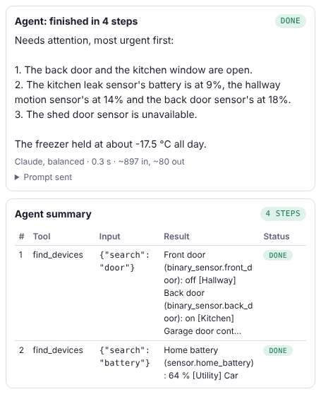

# The agent

[← Second Thought](../README.md) · [Using the page](using-the-page.md) · **The agent** · [Connections](connections.md) · [MCP tools](mcp.md) · [Running exported programs](running.md) · [Program format](program-format.md) · [Settings and models](settings.md)

*The agent block: a model that plans, uses tools, and checks its own work, with the tools it can be given and what always asks first.*

## The agent

Most programs do exactly what the blocks say, in order. An **agent** is different: you give it a **goal** and some **tools**, and Claude decides what to do next. It picks a tool, looks at what happened, and picks again. When the goal is met, it writes its answer into the draft.

The olive block **agent: work toward …** holds the tools, which have their own category, **Tools**, just below **Agent**. Drop in as many as you like:

- **ask me a question**, for things only you know.
- **remember and recall notes**, to keep what it learns for next time. It can also **search its notes**, so even among hundreds it finds the right one by its content, without knowing its exact name.
- **search the web and read pages**, for things that change. It can search, then read a source page in full. Reading pages only works in exported Python, and only public pages, never addresses on your own network.
- **work out sums**, so numbers are calculated exactly, not guessed: + − × ÷, powers, brackets and rounding, like `round(350 / 500 * 100, 1)`.
- **clock times and dates**, for the time now and for adding or taking away minutes, like 09:30 plus 270 minutes. Good for working backwards from when you want bread out of the oven.
- **read a file I choose**: the agent asks you for a PDF, a Word file or a text file and reads it.
- **check text against criteria**: a separate, strict reviewer checks the agent's work and lists the problems, so the agent can fix them before it finishes.
- **news feeds**, to read the latest from news sites and blogs (RSS or Atom).
- **search LinkedIn**, through the web search. LinkedIn doesn't let programs search it directly, so this only finds what LinkedIn shows everyone.
- **calendar**, to list your events and find free time.
- **email: search and read**, and **email: send**.
- **GitHub: projects and pull requests**, to find pull requests waiting for your review and read what they change, list a project's branches and commits, and read its files. **GitHub: comment, open and label issues** comments on pull requests and issues, opens new issues, and adds labels the project already has.
- **Telegram: search my messages** and **Telegram: send**.
- **Discord: search my channels** and **Discord: send**, and the same for **Slack**. They only read and post in the channels in your settings.
- **MQTT: read topics** and **MQTT: publish**, for sensors and switches that talk MQTT (like Zigbee2MQTT).
- **Home Assistant: look at devices**, including how a sensor changed over the last day, and **control devices**. Control devices asks you before every change, because something the agent reads could try to trick it. If you trust everything it reads, choose **control devices (no asking)**.
- **tool: My Block**, to turn one of your own My Blocks into a tool. Write a clear sentence about what it does, because that sentence is all the agent knows about it. **Ask me before each use** starts ticked, so you approve before your block runs. That matters if the block changes something. Untick it for blocks that only work something out, like a calculator.
  In **input types**, say what each input must be, like `flour grams: number; water grams: number`. The types are text, number, yes/no, list and any. The agent's input is checked before your block runs; if it's wrong, for example words where a number should be, the block doesn't run and the agent is told what to fix.

Tick **say where each fact came from** and an agent with a web tool puts the address of each fact's page after it and ends with a list of sources. If the answer cites an address the run never read, the run log adds a **Sources not read** note naming it, because that source was made up or remembered, not checked.

Tick **make a plan first** and the agent writes a short plan with its first step, then changes it if something surprises it. The plan shows in the run log, and costs nothing extra, because it travels with the steps.

Each step is one model call, so set how many steps it may take. If it runs out of steps, the draft holds whatever it found last. If a reply comes back unreadable, or it asks for the same tool with the same input twice in a row, the agent tells it and tries again; that uses a step. Three repeats in a row and the agent stops.

An agent only reads the words tools send back. It never follows instructions inside them, and it can't unlock a door without asking you. Tools that send or change something (email, Telegram, GitHub comments, MQTT publish, controlling devices) ask you before each use, because an email, a web page or a pull request can contain words written to trick the agent. Telegram has a **send (no asking)** choice for a bot that answers on its own. Even with the no-asking tools, unlocking, opening and disarming always ask, and so do the things that could do anything when the agent chooses them: Home Assistant scripts, scenes, automations and buttons, Homey flows, and MQTT messages that say unlock, open or disarm. An agent that can see private things (email, messages, your home, memory) also asks before reading a page address it made up, since the address could carry your data away. [SECURITY.md](../SECURITY.md) has the details.

When the agent finishes, the run log shows an **Agent summary**: one row per step, with the tool, what it sent, what came back, and how it went. You get it even if the run stops part-way. The block **agent's steps** gives the same as a list, for your program to check, save or have reviewed.

On the page, the feeds, GitHub, email, Telegram and the calendar use **sample** data, so you can try everything safely; nothing real is read or sent. Exported programs use your real accounts: see [Connections](connections.md#connections) for the settings.

There are 19 agent examples under **Agents** in **Browse examples**. **Agent: plan my bake** asks and remembers. **Agent with your own tool** uses a My Block. **Agent: bake timetable** works backwards with the clock. **Agent: scale a recipe** does every sum with the sums tool. **Agent: write, check, improve** fixes its work until a reviewer passes it. **Agent: check my recipe file** reads a file you choose. **Agent: research with sources** searches and reads its sources. **Agent: house check-up** and **Agent: bedtime round** look after a Home Assistant house, and the bedtime round asks before switching anything off. **Agent: news round-up** reads your feeds and skips what it showed you last time. **Agent: trip planner** checks your calendar and builds a plan with times and a budget. **Agent: pull requests for me** and **Agent: review and comment on a pull request** work with GitHub. **Agent: inbox triage** sorts your email and drafts replies. **Agent: plan my week** fits baking around your calendar. **Telegram bot that answers** replies to messages you send your bot. **Agent: find people on LinkedIn** searches LinkedIn's public pages.

---

Next: [Connections](connections.md) · [Back to the README](../README.md)
