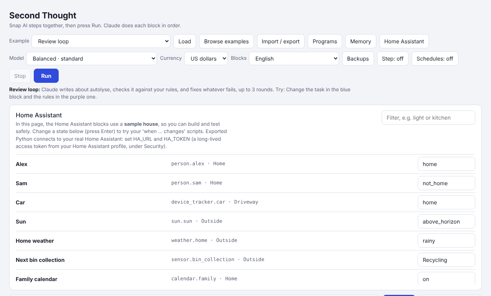

# Connections

[← Second Thought](../README.md) · [Using the page](using-the-page.md) · [The agent](agent.md) · **Connections** · [MCP tools](mcp.md) · [Running exported programs](running.md) · [Settings and models](settings.md)

*What programs connect to: Telegram, email, calendars, feeds, web requests, GitHub, Home Assistant and Homey.*

## Connections

The pink **Connections** blocks work without an agent too.

**Listeners** start a script when something arrives:

- **when a Telegram message arrives**, for messages to your bot.
- **when a Discord message arrives** and **when a Slack message arrives**, for messages in your channels, checked every 10 seconds. Only the channels in `DISCORD_CHANNEL_ID` or `SLACK_CHANNEL_ID` count, because anyone in a server or workspace can post; the bot's own messages never count. Discord needs the bot's *Message Content Intent* turned on.
- **when an MQTT message arrives on …**, for a sensor or switch. `+` stands for one level of the topic and `#` for everything below, like `zigbee2mqtt/#`.
- **when a web request arrives at /…**, for Home Assistant automations, IFTTT, or a shortcut on your phone. Every request must carry your `WEBHOOK_SECRET`, or it's refused. Until you set one, the program doesn't listen for web requests at all. By default only the same computer can reach it; see `WEBHOOK_HOST` below to let other devices in.
- **when an email arrives containing …**, checked every 2 minutes.
- **when there's something new in feed …**, checked every 15 minutes.
- **when a file appears in folder …**, for scans, downloads or recipes you drop in. It reads the words in PDFs, Word files and text files. For a picture (PNG, JPEG, WebP or GIF), **what arrived: picture** gives the picture itself, for the picture blocks.
- **when a pull request asks for my review**, checked every 5 minutes.
- **when a new issue is opened in** `owner/name`, checked every 5 minutes (pull requests don't count), and **when a release is published in** `owner/name`, checked every 15 minutes. **what arrived** gives the issue's `number`, `title`, `body`, `author` and `labels`, or the release's `tag`, `name`, `previous_tag` and `notes`.
- **when a calendar event starts in … minutes**, for reminders.
- **when the web page … changes**, for a price, a stock notice, opening times or the council's bin page. Fill in **only the part containing …** (like `Price`) to watch just the lines with those words and the two lines after each, so adverts and visitor counters elsewhere on the page don't count. It checks every 60 minutes unless you say otherwise. The first check only remembers the page. What changed is in `changed`, with `before` and `after`. The last copy of each page is kept in `watched-pages.json`, next to the program, so a restart doesn't count every page as changed. Pages that need a browser to show their words can't be watched.

**what arrived** gives what started the script. Every listener gives `text`, which sums it up; each block's tooltip lists its other fields, like `subject` for an email or `topic` for MQTT. **Telegram message** gives a Telegram message's words, sender or chat. On the page, right-click a listener and choose **Run this script** to try it with a sample of what arrives. Listeners only listen while the exported program runs on schedule.

**Other blocks:**

- **latest MQTT message on …** reads a topic, and **publish MQTT … to topic …** sends one. With **ask me before any smart home action**, publishing asks you first.
- **send Telegram message**, **send Discord message**, **send Slack message** and **send email** send something. The Discord and Slack ones reply in the channel a message came from, or post in your first channel. With **ask me before sending messages and announcements**, they ask you first.
- **news from feed** gives a list of the latest items. Leave it empty for your own feeds.
- **calendar for the next … days** gives a list of your events.
- **files in folder … matching …** gives a list of the files in a folder, newest first (name, path, modified, size), like every `*.pdf`. It only looks; it doesn't read them.

Try **Morning briefing on Telegram** and **Email me a news digest** under Automation, and the listener examples: **Proofer too warm? (MQTT)**, **When the bread is done (web request)**, **When the flour shop emails**, **Tell me when a feed posts something useful**, **Convert recipes dropped in a folder**, **When someone asks for my review (GitHub)** and **A reminder before each event**. Press Run to try each with something you type. Under Agents, **Agent: check the sensors (MQTT)** looks over your MQTT devices.

**Settings.** An exported program's `second-thought.ini` asks only for what it uses:

- **GitHub:** `GITHUB_TOKEN`, from github.com/settings/tokens. Read access is enough to look; to comment, it also needs write access to pull requests.
- **Telegram:** in Telegram, message **@BotFather** and send `/newbot`. It gives you `TELEGRAM_BOT_TOKEN`. Then message your bot and run the program: it tells you your chat number for `TELEGRAM_CHAT_ID`. Anyone can message a bot, so it only listens to, and searches, the chats you list there. A bot only sees messages sent to it, so it can't search your other chats.
- **Email:** `EMAIL_ADDRESS` and an **app password**, not your normal password (in Gmail, it's in your Google account under Security). Gmail, iCloud, Yahoo and Fastmail find their own mail servers. For anything else, fill in `EMAIL_IMAP_HOST` and `EMAIL_SMTP_HOST`.
- **Calendar:** `CALENDAR_URL`, your calendar's private iCal address. In Google Calendar it's under Settings, your calendar, **Secret address in iCal format**. It can read your calendar, but not add to it.
- **News feeds:** `feeds = ` and the feed addresses, separated by spaces.
- **MQTT:** `MQTT_HOST`, your broker's address (for Mosquitto in Home Assistant, that's your Home Assistant), plus `MQTT_USERNAME` and `MQTT_PASSWORD` if it needs them. `MQTT_TLS = yes` makes it encrypted. It needs the paho-mqtt library, which run.bat and run.sh install.
- **Web requests:** `WEBHOOK_SECRET`, a long password, and `WEBHOOK_PORT` if 8765 is taken. Call `http://127.0.0.1:8765/<address>?key=<your secret>` from the same computer, or put the secret in an `X-Second-Thought-Key` header. The program only listens on this computer unless you add `WEBHOOK_HOST = 0.0.0.0`, which lets Home Assistant on another machine, IFTTT or your phone reach it at `http://<this computer>:8765/…`.

The agent only reads **public** web pages and feeds, never addresses on your own network, in case something it reads tries to steer it there. Your own feeds and calendar address are fine wherever they are. To let the agent read pages on your own network, add `local_pages = yes`.

To keep listening all the time, run the program with **run-on-schedule** (see [Running on a schedule](running.md#running-on-a-schedule)). Things that arrived while it was off don't start the script: Telegram messages are kept for searching, and the email, feed, GitHub and folder listeners start from what's new after the program starts.

## Home Assistant



Second Thought talks to [Home Assistant](https://www.home-assistant.io), with its own blue blocks:

- Read state: "Is the back door open?"
- Take a camera snapshot, so a model can say who is at the door.
- Turn a light off, or send a notification to a phone.
- A yellow block starts a script when something changes, like the doorbell ringing.
- Another starts a script the moment Home Assistant fires an **event**, like a button on a remote.

On the page, these blocks use a **sample house**, so you can try everything safely. Press **Home Assistant** to see it, change something (the doorbell, say), and watch your program react. There are more than 60 Home Assistant examples in **Browse examples**.

**Safety rule:** Second Thought never unlocks a door, opens the garage or switches off the alarm without asking you first.

**Using your real Home Assistant.** Export the program and unzip it on a computer on the same network. Make a long-lived access token in Home Assistant (your profile, then the Security tab), and put it in `second-thought.ini`:

```
[home assistant]
HA_URL = http://homeassistant.local:8123
HA_TOKEN = your-long-lived-token
```

Then run `run-on-schedule.bat` (Windows) or `sh run-on-schedule.sh` (Linux or Mac). On an always-on Linux computer, `sh install-service.sh` keeps it running for good. A small always-on virtual machine or container is a good home for it.

`--schedule` keeps it running, so timed jobs and "when it changes" scripts start by themselves. **when Home Assistant event … happens with …** listens on Home Assistant's WebSocket, using the same `HA_URL` and `HA_TOKEN`, so it reacts at once instead of polling. Use it for remote and button presses (`zha_event`, `deconz_event`, `hue_event`), `automation_triggered`, phone notification actions or your own events. Type `anything` for every event. The second box is optional words the event's data must contain, like the remote's name. **what arrived** gives `event_type`, `entity`, `data`, `time`, `text`, and each field of the event's data, like `command`. *Developer tools → Events* in Home Assistant shows what your devices send.

## Homey

Second Thought also talks to **Homey Pro**, with its own green blocks under **Homey**:

- **when Homey device … … changes** starts a script when a device's value changes, like the washing machine's power dropping. **what arrived** says which device, what changed, and from what to what.
- **… of Homey device …** reads one value, like `measure_temperature` of the Proofing box.
- **Homey devices matching …** lists devices and everything they report.
- **set Homey device … … to …** switches something, like `onoff` to `off` or `dim` to `0.5`.
- **run Homey flow …** starts one of your flows. A flow can do anything your Homey can, like sending a Homey notification.
- **Homey variable …** and **set Homey variable … to …** read and change your Logic variables, so your flows can use them.

There are agent tools too, under **Tools**: **Homey: look at devices, flows and variables**, and **Homey: control devices and start flows**, which asks you before each change. On the page these blocks use a **sample Homey home**; try the examples under **Homey** in **Browse examples**. The same safety rule applies: unlocking, opening the garage and switching off the alarm always ask you first.

**Using your real Homey.** In the Homey Web App (my.homey.app), open Settings, then API Keys, and make a new key with only the permissions the program needs: view devices, control devices, view and start flows, and view and edit Logic. Put it in `second-thought.ini` with your Homey's address:

```
[homey]
HOMEY_URL = http://homey-XXXXXXX.local
HOMEY_API_KEY = your-api-key
```

The address is in the Homey app under Settings, General. The computer running the program must be on the same network. API keys work with Homey Pro (2023 and later) and Homey Pro mini.

**Homey Self-Hosted Server** serves the same API on port **4859**, so use the address of the computer it runs on, with `:4859` on the end:

```
HOMEY_URL = http://192.168.1.20:4859
```

Make the API key in the Homey Web App the same way. A **Homey Bridge** connected to a Self-Hosted Server needs nothing of its own: its devices show up through the server. To check it all works, run `python tools/smoke_test.py homey`. It only reads, so nothing is switched.

---

Next: [MCP tools](mcp.md) · [Back to the README](../README.md)
