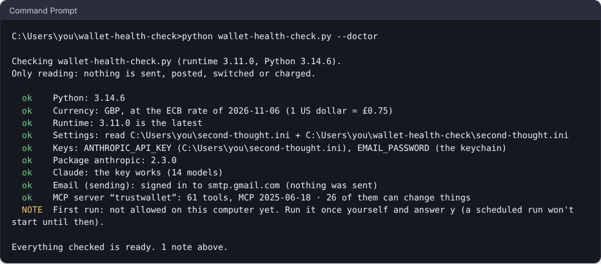

# MCP tools

[← Second Thought](../README.md) · [Using the page](using-the-page.md) · [The agent](agent.md) · [Connections](connections.md) · **MCP tools** · [Running exported programs](running.md) · [Settings and models](settings.md)

*MCP servers: any server's tools in an agent, GitHub, Kraken and Trust Wallet, and serving your own program as a tool.*



## MCP tools

The agent can borrow tools from [MCP](https://modelcontextprotocol.io) servers: there are MCP servers for files, GitHub, databases, calendars and hundreds of other jobs. To give one to your agent, put this block inside it:

```
tools from MCP server  files   (asks me before tools that change things)
```

Then tell the exported program where the server is, in `second-thought.ini`. A server that starts on your computer:

```
MCP_FILES = npx -y @modelcontextprotocol/server-filesystem /home/me/recipes
```

A server at an address:

```
MCP_TRACKER = https://mcp.example.com/mcp
MCP_TRACKER_TOKEN = your-token
```

The name in the block (`files`) and the name in the settings (`MCP_FILES`) must match.

When the agent runs, it asks the server which tools it has and uses them like its own. Each tool says whether it only looks at things or can change them; the agent asks you before using one that changes things, unless you choose **(no asking)**. Choose **(asks me before every tool)** to be asked about all of them.

A tool its server marks as one that can delete or overwrite (`destructiveHint`) always asks, even with **(no asking)**, and so never runs when nobody is there to answer. `--doctor` lists each server's tools and says how many of them can change things.

MCP servers only work in exported programs. On the page, the agent works without them, and the run log says so.

### Docker MCP Toolkit

Docker Desktop's MCP Toolkit runs MCP servers in containers, behind one gateway. The gateway speaks stdio unless told otherwise, so it works as a server here:

```ini
[mcp servers]
MCP_DOCKER = docker mcp gateway run
```

Then put `tools from MCP server docker` inside an agent: it gets the tools of every server you've turned on in the Toolkit. Their changes ask first, like any MCP server's. This has not been tried against a real Docker Desktop yet; `--doctor` lists the tools it finds. For containers' health, memory and logs, the [Docker blocks](connections.md#docker) need no gateway.

### GitHub

GitHub's own MCP server ([github-mcp-server](https://github.com/github/github-mcp-server)) lets an agent read a repository properly: its files, the file tree, code search, issues and pull requests. For reading, start it with `--read-only`, so it offers no tool that can change anything, and give it a [fine-grained token](https://github.com/settings/personal-access-tokens) that can only read (Contents, Issues, Pull requests and Metadata):

```ini
[mcp servers]
MCP_GITHUB = docker run -i --rm -e GITHUB_PERSONAL_ACCESS_TOKEN ghcr.io/github/github-mcp-server stdio --read-only --toolsets repos,issues,pull_requests
GITHUB_PERSONAL_ACCESS_TOKEN = your-read-only-token
```

Then put `tools from MCP server github` inside an agent. Without Docker, `MCP_GITHUB = https://api.githubcopilot.com/mcp/` with the token in `MCP_GITHUB_TOKEN` uses GitHub's hosted server. Started without `--read-only`, its changes (issues, comments, pull requests) ask first, unless you choose (no asking); merging, pushing, changing or deleting files and making, forking or deleting repositories **always** ask, and never run unattended. `--doctor` should say 0 of its tools can change things.

The **Review a GitHub repository** program in the gallery uses it: the agent reads a repository's tree, README, main files and issues, and writes an assessment where every point names the file or issue it came from. The older GitHub connection (`GITHUB_TOKEN`, for blocks like the pull request round-up) stays as it is: use it for those blocks, and the MCP server when an agent needs to look around a repository.

### Kraken

For crypto, the **Kraken tools** block gives the agent [Kraken](https://www.kraken.com)'s own MCP server, from [kraken-cli](https://docs.kraken.com/home/mcp), with no settings to write:

```
Kraken tools  (prices, your account and paper trading)
```

That's market prices, your balances, orders and trade history, and paper trading at live prices, which never touches your money. Choose **(and live trading: asks before every order)** to let it place real spot orders too. Install kraken-cli first. For your account, put `KRAKEN_API_KEY` and `KRAKEN_API_SECRET` in `second-thought.ini`, from a Kraken API key with the fewest permissions it needs: query only, unless the program trades, and never withdrawal. Prices and paper trading need no key.

Every Kraken tool that can move real money (orders, futures, staking, transfers, withdrawals) **always asks you first**, even with (no asking) and even in a 'tools from MCP server' block, and never runs when nobody is there to answer: on a schedule, on GitHub Actions or with `--mcp`, it's refused and the run log says why. Kraken asks agents to set `acknowledged: true` on those calls; the agent never can, only your yes does. The list works the safe way round: only the Kraken tools known not to move money (market data, your account's history, paper trading) skip that question, so a tool added by a later kraken-cli asks until it has been checked. `--doctor` checks kraken-cli is installed and your key works, and fails if `MCP_KRAKEN` has `--allow-dangerous`.


### Trust Wallet

[Trust Wallet](https://trustwallet.com)'s Agent Kit (`twak`, from `npm install -g @trustwallet/cli`) runs an MCP server for your self-custody wallet. Set it up with `twak init` and `twak wallet create`, then name the server `trustwallet`:

```ini
[mcp servers]
MCP_TRUSTWALLET = twak serve
TWAK_ACCESS_ID = your-access-id
TWAK_HMAC_SECRET = your-hmac-secret
```

and put `tools from MCP server trustwallet` inside an agent. Balances, your portfolio, prices, history, swap quotes and token risk checks run without asking. Its tools don't say which only look, so Second Thought works the safe way round, as with Kraken: **everything else counts as money** (transfers, swaps, token approvals, payments, and any tool a later twak adds), so it always asks you first, even with (no asking), and never runs when nobody is there to answer. The agent can't set twak's `autoApprove`; only your yes does. Automations (`create_automation`) are never offered to the agent, because they trade later, inside twak, where nothing here can ask. On-chain sends can't be undone, so keep the wallet's password in your system's keychain, as twak does by default, rather than in `second-thought.ini`.

The **Wallet health check** program in the gallery uses it: each Sunday it emails what you hold, what it's worth, and any token whose risk check looks bad. It only reads.
---


### Your program as an MCP tool

It works the other way round too: `python my-program.py --mcp` serves the program as an MCP server (over stdio) with one tool, named after the program. Claude Desktop, Claude Code or any agent that speaks MCP can then call it. Whatever the agent passes as `value` becomes the program's **message value**, each call runs the 'when Run is clicked' scripts, and the program's result comes back as the tool's answer. To add it to Claude Desktop, put this in its MCP settings:

```json
{"mcpServers": {"my-program": {"command": "python", "args": ["/full/path/to/my-program.py", "--mcp"]}}}
```

Nobody is at a keyboard when an agent calls it, so a question (an **ask me** or **approve** block) makes the call fail with the reason, and an action that would ask first is refused, as on a schedule. A program that can act on the world serves only once it's been allowed to without asking: run it once in a terminal and answer y, or put `approve = no` in `second-thought.ini`. That's deliberate: an agent calling your program shouldn't be able to do more than you'd let it do unattended. `--doctor` names the tool it would serve.

---

Next: [Running exported programs](running.md) · [Back to the README](../README.md)
