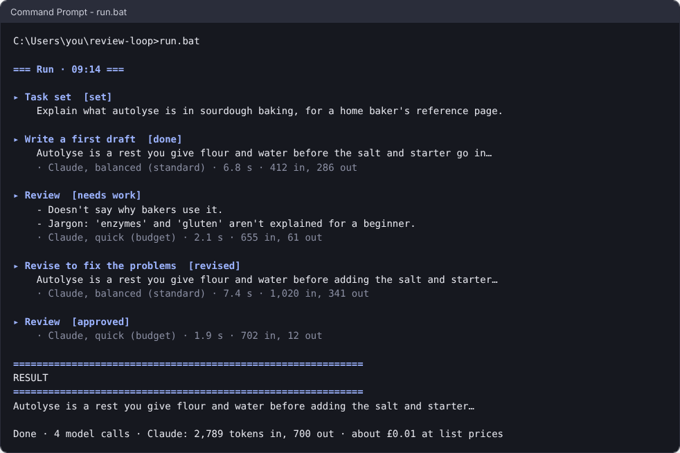
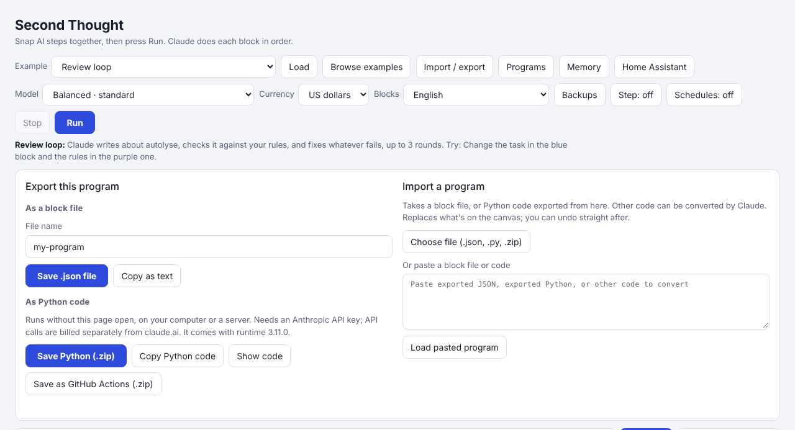

# Running exported programs

[← Second Thought](../README.md) · [Using the page](using-the-page.md) · [The agent](agent.md) · [Connections](connections.md) · [MCP tools](mcp.md) · **Running exported programs** · [Program format](program-format.md) · [Settings and models](settings.md)

*Exporting to Python and running it: on a schedule, on GitHub Actions, approving what it can do, test cases, memory, and keeping it up to date.*



## Exporting to Python



An exported program runs on any computer by itself, with the page closed. It talks to the model services directly, so it needs an API key, and calls are billed by the service, separately from claude.ai.

Press **Import / export**, then **Save Python (.zip)**, and unzip it into a folder of its own:

| File | What it is |
|---|---|
| `my-program.py` | The program, with the runtime built in. |
| `second-thought.ini` | Settings, including keys. It lists only what *this* program needs. |
| `run.bat` | Windows: double-click to run. |
| `run.sh` | Linux or Mac: the same job as `run.bat`. |
| `requirements.txt` | The packages it needs. `run.bat` and `run.sh` install them for you. |

Open `second-thought.ini` in any text editor, put each key after its `=` sign, and save:

```
[keys]
ANTHROPIC_API_KEY = sk-ant-your-key-here
```

Keep this file private: it holds your keys.

**On Windows:** install Python from python.org (tick **Add python.exe to PATH**), then double-click `run.bat`. The first time, it installs what the program needs.

**On Linux or a Mac:** in a terminal in the folder, run:

```
sh run.sh
```

The first time, it makes a private `.venv` next to the program and installs into that, so nothing is installed for the whole computer. (On Debian or Ubuntu, if it can't set up Python, run `sudo apt install python3-venv` first.)

### Running on a schedule

If a program has timed jobs or listeners, the zip also has `run-on-schedule.bat` and `run-on-schedule.sh`. These keep running, so the jobs start by themselves, and if the program stops with a problem they start it again 30 seconds later.

To start it automatically:

- **Windows:** double-click `install-startup.bat` once. The program then starts in a small window each time you log in. To undo it, press Windows+R, type `shell:startup`, and delete "Second Thought - my-program".
- **Linux or a Mac:** run `sh install-service.sh` once. On Linux it starts whenever the computer starts (it asks for your password to set this up); on a Mac, whenever you log in. It tells you how to watch what the program is doing, and how to turn it off.

### On a home server

The zip's own installers cover a computer someone logs in to. On a box nobody logs in to — the one under the stairs — the same jobs want a little more: start at power-on with nobody's session, start again after a crash, and keep the program inside its own folder. Run the program once yourself first and answer its approval question (`y`), or put `approve = no` in `second-thought.ini` if you're sure.

**Linux (systemd).** `sh install-service.sh` already installs a unit that starts at boot as you. For the harder-walled shape, put this in `/etc/systemd/system/second-thought-my-program.service` (it's the same unit, with the walls named):

```ini
[Unit]
Description=Second Thought: my-program
After=network-online.target
Wants=network-online.target

[Service]
WorkingDirectory=/opt/second-thought/my-program
ExecStart=/bin/sh run-on-schedule.sh
Restart=on-failure
RestartSec=30
User=me
ReadWritePaths=/opt/second-thought/my-program
ProtectSystem=strict
ProtectHome=read-only
PrivateTmp=yes
NoNewPrivileges=yes

[Install]
WantedBy=multi-user.target
```

Then:

```sh
sudo systemctl daemon-reload
sudo systemctl enable --now second-thought-my-program
```

`ProtectSystem=strict` makes everything read-only except what the program needs, and `ReadWritePaths` gives it back its own folder (where `memory.json`, `outputs/` and its log live). Keep the folder out of your home folder, or give that path in `ReadWritePaths` too — `ProtectHome=read-only` stands in the way otherwise. Watch it with `journalctl -u second-thought-my-program -f`, stop it with `sudo systemctl disable --now second-thought-my-program`. And keep `chmod 600 second-thought.ini`, since it holds your keys: the keychain's Secret Service needs your login session, so on a headless box the ini (or an `EnvironmentFile=` with the same permissions) is the honest place for them.

**Windows (Task Scheduler).** `install-startup.bat` starts the program when you log in. To run it whether anyone is logged in or not, in an administrator PowerShell, once (it asks for your password, which is what lets it run with nobody there):

```powershell
$dir = 'C:\second-thought\my-program'
Register-ScheduledTask -TaskName 'Second Thought: my-program' `
  -Action   (New-ScheduledTaskAction -Execute "$dir\run-on-schedule.bat" -WorkingDirectory $dir) `
  -Trigger  (New-ScheduledTaskTrigger -AtStartup) `
  -Settings (New-ScheduledTaskSettingsSet -RestartCount 3 -RestartInterval (New-TimeSpan -Seconds 30) `
             -ExecutionTimeLimit ([TimeSpan]::Zero) -AllowStartIfOnBatteries -DontStopIfGoingOnBatteries) `
  -User $env:USERNAME
```

`-AtStartup` starts it when the computer starts; `-RestartCount` starts it again after a crash, and `-ExecutionTimeLimit ([TimeSpan]::Zero)` turns off the 72-hour limit that would otherwise stop a program whose job is to keep running. See how the last run went in Task Scheduler (Last Run Result), or run `run-on-schedule.bat` yourself in a terminal to watch it live. To stop it for good:

```powershell
Unregister-ScheduledTask -TaskName 'Second Thought: my-program'
```

### Running on GitHub Actions

A program whose scripts start at set times ('when it's …' and 'every …') can run on GitHub's computers instead, so yours doesn't need to be on. In Import / export, choose **Save as GitHub Actions (.zip)**. The zip has the program, a workflow in `.github/workflows/`, and `SETUP.md`, which lists the repository secrets to add (your keys). Put the files in a **private** repository, add the secrets, and the scripts run at their times. The **Run workflow** button on the Actions tab runs one now.

If the program has test cases (**Save as test case** after a good run), the workflow runs them too: whenever you push a change to the program, its tests or the workflow, and from **Run workflow**. They never run on the schedule, since they call the real models. A failed case shows on the run's page, and the run's summary has a table of every case and what the tests cost. `SETUP.md` shows how to make the scheduled runs wait while the last test run has failed.

- **Times:** GitHub's schedules are in UTC. The workflow is worked out for your time zone. Where the clocks change, each time has a winter line and a summer line, and the program only runs a script within an hour after its time, so the other line does nothing. GitHub often starts runs a few minutes late, sometimes skips one when it's busy, and runs 'every' scripts at most every 5 minutes.
- **What it remembers:** after each run, `memory.json` and `outputs/` are committed back to the repository. That's why the repository should be private. To keep them out of it, the workflow says how to use `actions/cache` instead, but GitHub deletes a cache it hasn't used for 7 days.
- **Approval:** adding the workflow is your yes to what the program can do (`SETUP.md` lists it), so it runs with `approve = no`. An agent tool that asks first still gets no answer there, so it says no.
- **What can't run there:** programs that wait for things to happen (messages, web requests, changes, new files); programs that use Llama, MCP servers or folders on your computer; and programs whose scheduled scripts ask you questions. The page says which, and why. Home Assistant, Homey and MQTT have to be reachable from the internet.
- **Free minutes:** on GitHub's free plan, private repositories get 2,000 a month, and a run takes about a minute.
- **When it fails:** the reason is on the run's page on GitHub, under Annotations, as well as in the log.
- **Claude keys:** make the key inside a workspace (the Console's Workspaces page). A key made for the whole organisation also needs the `ANTHROPIC_WORKSPACE_ID` secret.

**Checked on GitHub** (October 2026, #226). The *Rain window* gallery program, saved as GitHub Actions for Europe/London into a private repository with its three secrets, ran from the Run workflow button: the secrets reached the program, the time zone was London's, the right script ran, the forecast was looked up and the answer arrived on Telegram, in 27 seconds. The scheduled runs start from the cron lines as above. That first real run found what's now fixed: a Claude key made for a whole organisation was refused (so `ANTHROPIC_WORKSPACE_ID` and a plain explanation), the reason for a failure was only in the log, the end of a failed run said to run it again to carry on (which can't happen there), the actions were the old Node.js 20 ones, and Telegram showed the reply's Markdown asterisks instead of bold. What it remembers being committed back is checked by the tests with stand-in services, since the program used doesn't remember anything.

The workflow runs `python my-program.py --run-schedule 2`, which runs scheduled script 2 once, if it's due. You can use the same thing with any scheduler, such as cron or Windows Task Scheduler: add `--now` to run it whatever the time.

### Approving what a program can do

A program that does real things (sends email or messages, switches lights, posts on GitHub) asks you before it runs the first time:

```
This program can:
  - send email
  - read your calendars
It sends what it reads and writes to Claude.

Approve? [y/n] >
```

It remembers your answer until the program changes; a changed program might do different things, so it asks again. The same list is written at the top of the program, and the page shows it when you import one.

A scheduled program, with nobody there to answer, won't start until you've approved it once, so run it yourself first. If you're sure, and the computer is unattended, put `approve = no` in `second-thought.ini`.

If a program has an **ask me before** block, Python asks in the terminal and waits for `y` or `n`. With nobody there to answer, it says no and carries on.

### Test cases

A program that checks its own work deserves a check of its own, especially after you change its model. After a run you're happy with, press **Save as test case** under the result, and say what any good result must do, like *mentions the date; under 200 words; no jargon*. The test case keeps your answers to the program's questions and the files you chose. **Run tests**, at the top of the run log, runs every test case again: it gives the same answers instead of asking, the models answer afresh, and a strict reviewer checks each result against its criteria. The log ends with which passed, and why the others didn't.

Test cases travel with the program: in block files, saved programs, exported Python, and in the zip as `my-program.tests.json`. There, `python my-program.py --test` runs them. Nothing acts in a test: messages aren't sent, devices aren't switched and files aren't saved (the log says what would have been done), and memory is a copy, so tests can be run as often as you like. It prints PASS or FAIL for each, and exits with 1 if any failed, for scripts. Pictures aren't kept, so a test can't choose one.

## Memory and shared files

Memories saved "forever" live in `memory.json`, next to the program. Two programs can share one memory file (`RB_MEMORY_FILE`): they take turns to save, so neither loses the other's changes, and a save is never left half-written if a program stops part-way. Two programs using the same Telegram bot share `telegram-messages.json` the same way, and a message is only handled once.

## Versions and --doctor

Every exported program carries its own copy of the runtime, with a version number. To see which one a program has:

```
python my-program.py --version
```

To check a program has everything it needs before you rely on it:

```
python my-program.py --doctor
```

It checks each thing the program uses (keys, packages, Home Assistant, email, Telegram, MCP servers and the rest) and says **ok** for each that works, or **FAIL** with what to fix. It only looks: nothing is sent, posted or switched, and it uses no model tokens.

It also asks GitHub whether a newer runtime is out. A newer one is a **NOTE**; one whose release notes say it fixes a security problem is a **FAIL**. If GitHub can't be reached, that's a NOTE, never a failure. `update_check = no` in `second-thought.ini` turns the check off.

A program never updates itself, but you can update it in place:

```
python my-program.py --update-runtime
```

This downloads the newest release's runtime of the same major version, checks it against the SHA-256 published with it, and swaps it into the program file. The blocks, your settings and anything after the runtime stay as they are, and the old file is kept as `my-program.py.bak`. The file has changed, so a program that acts asks to be allowed again, saying what's new. A new major version isn't applied this way, since it may change what the program does: import the program on the page and export it again instead. Programs exported before runtime 3.1.0 don't have `--update-runtime`; export them again once.

[`CHANGELOG.md`](../CHANGELOG.md) says what changed in each version.

---

Next: [Settings and models](settings.md) · [Back to the README](../README.md)
