# Settings and models

[← Second Thought](../README.md) · [Using the page](using-the-page.md) · [The agent](agent.md) · [Connections](connections.md) · [MCP tools](mcp.md) · [Running exported programs](running.md) · [Program format](program-format.md) · **Settings and models**

*second-thought.ini and where settings come from, the run settings, and choosing models and backups.*

## Where settings come from



Everything in `second-thought.ini` can also be set as an environment variable with the same name; an environment variable wins over the file.

**Keys in your keychain.** To keep keys out of `second-thought.ini` (on a shared or backed-up computer, say), put them in your computer's keychain instead: macOS Keychain, Windows Credential Manager, or the Secret Service on Linux. Install the `keyring` package once, then store each key under the name `second-thought`:

```
pip install keyring
python -m keyring set second-thought ANTHROPIC_API_KEY
```

It asks for the key without showing it. A program then finds any key that isn't in the environment or `second-thought.ini` in the keychain. `--doctor` says where each key came from. Without `keyring` installed, nothing changes, and `keychain = no` in `second-thought.ini` turns it off.

[`second-thought.example.ini`](../second-thought.example.ini) lists every setting a program understands, with a note on each: keys for every model service, models and backups, run settings, Home Assistant, Homey, MQTT, Telegram, email, calendar, GitHub, web requests and feeds. Copy it to `second-thought.ini` and fill in what you use. Settings come in three layers, each one over the one before:

1. **`ST_` environment variables**, for every program on the computer: the setting's name after `ST_`, such as `ST_EMAIL_ADDRESS` or `ST_CURRENCY`. On Windows, `setx ST_CURRENCY gbp`, then open a new window.
2. **`second-thought.ini` in your home folder**, for what your programs share: email, keys, currency.
3. **The program's own `second-thought.ini`**, next to it (or in the folder you run it from, or wherever `SECOND_THOUGHT_INI` points), for what's particular to it.

So a program's own file only needs its own settings. An ordinary environment variable with the setting's usual name (`ANTHROPIC_API_KEY`, `RB_BUDGET`) still wins over all three, and the keychain fills in any key still missing. `--doctor` says which file or variable each key came from.

`--doctor` also notes any name in `second-thought.ini` that isn't a setting, which is usually a spelling mistake (`save_logg`); a name an MCP server or a command you run needs is fine. Settings never set `LD_*`, `DYLD_*` or `PYTHON*` names, which change how programs start, and `--doctor` says so if one was skipped. On Linux and Mac, keep `second-thought.ini` to yourself with `chmod 600 second-thought.ini`: `--doctor` notes it if other people can read it.

## Run settings

The ini file has a `[run]` section. Remove the `;` from the start of a line to switch it on:

```
[run]
budget = 50000
save_log = yes
```

- `budget` stops each run before a model call once it has used that many tokens. In Python the count is exact, because every service reports its usage. A **limit this run** block wins over this line.
- `budget_dollars` does the same in US dollars, at the models' list prices, like `budget_dollars = 0.50`. That's safer for a program that runs on its own, on a schedule or on GitHub Actions. A model whose price isn't known can't be counted, so a run that would use one stops and says so, rather than going on with no limit; backups with no known price are skipped. A run checks before each call, so its last call can take it a little past the amount.
- `currency = gbp` shows costs, and the money budget, in pounds sterling. `eur`, `jpy` (yen) and `cny` (yuan) work too; `usd` is the default. Services charge in US dollars, so the program converts at the European Central Bank's rate of the day, fetched once a day and kept next to the program. Offline, it uses the last rate it kept, or one built into the program, and never goes without a rate. `exchange_rate = 0.79` fixes one US dollar in your currency instead. Your card's own rate and fees may differ from the program's figure. On the page, choose **Currency** beside the model: the page can't fetch the day's rate, so it uses the built-in one and says its date.
- `quota_daily = 1.00`, and `quota_hourly`, `quota_weekly` and `quota_monthly`, are allowances for each key across every run of every program on this computer, in your currency. The end of a run says how much of each has gone, like *Claude key: 34% of the daily allowance of £1.00*, and a run stops before a call once one is used up, saying when it resets. `quota_daily_claude = 2.00` gives one service its own. The tally is kept next to `memory.json`, with a hash of each key, never the key itself. It can't see programs on other computers or your claude.ai use, and on GitHub Actions it starts afresh each run.
- `PLAN_CLAUDE = start` (or `PLAN_OPENAI`, `PLAN_GEMINI`, `PLAN_GROQ`) says which plan an account is on, using the service's own plan names. Where the service publishes a monthly spend cap (Claude and OpenAI do), the program counts this computer's spending against it, says how much has gone, like *Claude (Start plan): 12% of this month's $500.00 cap, counted on this computer*, and stops before a call once it's reached. Claude's cap runs by the month in UTC, as Claude's does. Claude, OpenAI and Groq also report their own rate limits with each reply: a saved log and `--doctor` show them, labelled as the service's, and the end of a run mentions them when one is nearly used up. If Claude's reported limits match one plan, the program suggests the `PLAN_` line, once. The agent tool **model services: usage, plans and limits** reports the same numbers on demand: what each service has spent in each window, the share of its plan's cap gone, any overspend, and the services' own reported limits.
- `budget_money = 0.40` is a money budget in that currency; it wins over `budget_dollars`. The **limit this run** block can also be set in pounds, euros, yen or yuan.
- `stream` shows the model writing as it goes, on one line that counts the characters. Normally this only happens when you run the program in a terminal yourself.
- `resume` is for runs that stop part-way, for example because the internet dropped or you pressed Ctrl+C. The program keeps a note of each finished step, and next time it can pick up where it stopped: model answers, your answers and messages already sent are reused, not asked or sent again. In a terminal it asks you first; set `resume = yes` or `resume = no` for unattended programs. If you change the program, it starts afresh.
- `max_seconds` stops any run that takes longer than that, whatever it's doing. `call_timeout` gives up on a single model call after that many seconds (300 by default; 0 means no timeout). If one of these is mistyped, the program stops straight away and says which setting is wrong.
- `save_log` keeps a log of every run in a `logs` folder next to the program. Each step records which model answered, how long it took and the exact tokens, with the prompts under **Prompt sent**.

Services rename and retire their models from time to time. `--doctor` says when a service no longer lists a model the program uses, and suggests one it does list. To use a different model without editing the program, add `MODEL_` and the tier's name in capitals, like `MODEL_OPENAI_DEFAULT = gpt-6.2-sol` or `MODEL_QUICK = claude-haiku-4-5-20251001`. `second-thought.example.ini` shows the pattern.

## Models

On the page, Claude does every job; blocks that name another model are answered by Claude instead, and the run log says so. Exported programs talk to each service directly. Each needs its own key, from its own company:

| Model | Made by | Runs in | Setting |
|---|---|---|---|
| **Claude** | Anthropic | America | `ANTHROPIC_API_KEY` |
| **Gemini** | Google | America | `GEMINI_API_KEY` |
| **GPT** | OpenAI | America | `OPENAI_API_KEY` |
| **Grok** | xAI | America | `XAI_API_KEY` |
| **DeepSeek** | DeepSeek | China | `DEEPSEEK_API_KEY` |
| **Mistral** | Mistral AI | France | `MISTRAL_API_KEY` |
| **Qwen** | Alibaba | Singapore, for people outside China | `DASHSCOPE_API_KEY` |
| **Kimi** | Moonshot AI | China | `MOONSHOT_API_KEY` |
| **Perplexity** | Perplexity | America | `PERPLEXITY_API_KEY` |
| **Hugging Face** | many open models | all over the world | `HF_TOKEN` |
| **Groq** | Groq | America | `GROQ_API_KEY` |
| **GLM** | Z.ai | China | `ZAI_API_KEY` |
| **MiniMax** | MiniMax | China | `MINIMAX_API_KEY` |
| **OpenRouter** | many companies, through one key | wherever each model runs | `OPENROUTER_API_KEY` |
| **Llama** | Meta, via Ollama | your own computer | `LLAMA_BASE_URL`, plus `LLAMA_API_KEY` if your server needs one |

Some notes:

- **How expensive:** the model menus, the run log and `--doctor` give each model a band from its list price per million output tokens. The bands are **free**, **budget** (up to $5), **standard** (up to $15) and **premium**. Llama on your own computer is free. A model whose price Second Thought doesn't know yet says **price unknown**, rather than guessing.
- **Who makes it:** for a service that runs other companies' models, the run log says both, like *Gemma 4, by Google, through Hugging Face*: the bill and the limits come from the service.
- **Llama** runs on your own computer, so nothing you ask it leaves the house. Install [Ollama](https://ollama.com) and download a model with `ollama pull llama3.2-vision:11b`. If Ollama runs on another computer, set `LLAMA_BASE_URL = http://that-computer:11434/v1`.
- **GPT:** a ChatGPT subscription isn't an API key. You need a key from OpenAI's developer site.
- **DeepSeek** is very cheap. It runs on DeepSeek's own servers in China, so keep it for things that aren't private.
- **Perplexity** searches the web for every question and lists the pages it read at the end of its answer. That makes it good for things that change, like prices and opening times. It can't look at photos.
- **Hugging Face** hosts a huge library of open models. Second Thought starts you on Google's Gemma, but you can choose almost any model in the library.
- **Groq** (with a q, not to be confused with Grok) is very fast, and good for jobs with lots of small steps.
- **OpenRouter** reaches hundreds of models from many companies with one key. Choose **OpenRouter, auto-pick** and it chooses a model for each job, or use **with OpenRouter model** and type the name of any model from openrouter.ai/models.

---

[Back to the README](../README.md)
