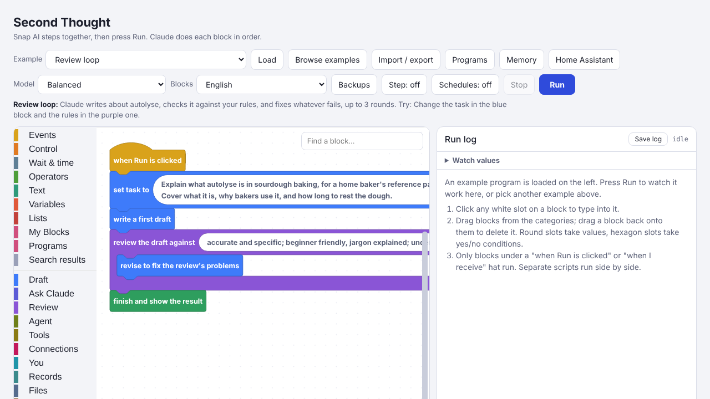
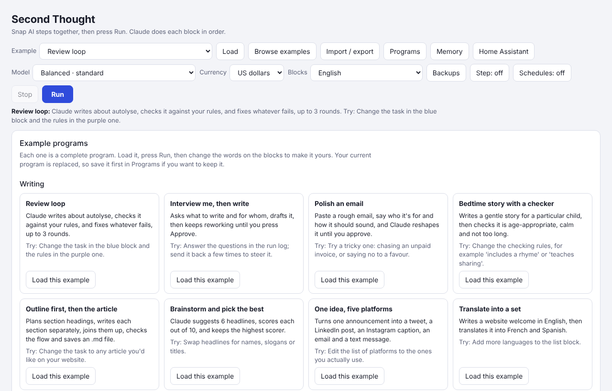

# Using the page

[← Second Thought](../README.md) · **Using the page** · [The agent](agent.md) · [Connections](connections.md) · [MCP tools](mcp.md) · [Running exported programs](running.md) · [Settings and models](settings.md)

*Building a program on the page: the blocks, what a program can do, the examples and gallery, saving, and the page's languages.*

## Using the page

**Where to open it.** [On claude.ai](https://claude.ai/artifact/XmNRmDbYLY3bo7o31nvdzN), runs use your claude.ai account and there's nothing to set up. There's also a copy at **[itsfja.github.io/second-thought](https://itsfja.github.io/second-thought/)**, updated with each release. It builds programs, tries them on sample data, explains and exports them. To run them with Claude there, press **Use your own API key** and paste an Anthropic API key (from [console.anthropic.com](https://console.anthropic.com)): runs are charged to that key's account. The key goes only from your browser to api.anthropic.com, is kept until you close the tab unless you tick **Remember on this browser**, and is never put in a saved program, an export or the run log; **Forget my keys** removes it. Or use the page on claude.ai, which needs no key. Exported Python runs anywhere either way.

**Your own model service.** Off claude.ai, the page runs programs with the service you choose in the **Model** menu, not only Claude. Choose it there, press **Use your own API key** (or **Add another key**), and the panel opens on that service: paste its key, and runs use it, with its own answers, its exact token counts and its own errors. That works for the twelve services that speak OpenAI's chat format: DeepSeek, Grok, OpenAI, Mistral, Qwen, Kimi, Hugging Face, Groq, GLM, MiniMax, OpenRouter, and Llama through Ollama. Each key goes only to its own service. The **Address** box points a service somewhere else, such as Ollama or LM Studio on your computer (start Ollama with `OLLAMA_ORIGINS=* ollama serve` so the page may call it; it needs no key). Some services may not accept calls straight from a browser; the run log says so if one can't be reached, and the exported program can still use it. Building and changing programs (*Describe a program*, *Change this program*) stay with Claude. On claude.ai nothing changes: runs use your claude.ai account.

**A copy on your own computer.** Clone the repository and serve its folder, for instance `python -m http.server` in it, then open `http://localhost:8000/second-thought.html`. It works like the GitHub Pages copy, but with no limit on which addresses it may call, so the **Address** box can point anywhere, such as a server at work.

**With no network.** Each [release](https://github.com/itsfja/second-thought/releases/latest) has **second-thought-offline.html**: the page as one file, with Blockly and every language inside. Open it from your disk and it builds, explains and exports programs with no connection at all; it runs them with your own key, as the GitHub Pages copy does, when you're online. Reading PDFs needs the network, as do the fonts for Linear B, cuneiform, hieroglyphs and Coptic.

Each block is one instruction, like *write a first draft*, *review the draft against …* or *revise to fix the review's problems*. Drag blocks from the categories on the left and click them together. Only blocks under a **when Run is clicked** or **when I receive** hat run, top to bottom; separate scripts run side by side. Click any white slot to type into it. Round slots take values, hexagon slots take yes/no conditions.

The blocks are colour-coded by job:

- **Yellow** starts things. **when Run is clicked** goes at the top.
- **Orange** repeats or chooses.
- **Blue** asks Claude to write.
- **Purple** asks Claude to check the writing.
- **Teal** asks *you* a question and waits for your answer.
- **Olive** makes an [agent](agent.md#the-agent), a helper that decides its own steps. Its tools are a darker olive, in their own **Tools** category.
- **Pink**, under **Connections**, talks to Telegram, email, your calendar and news feeds.
- **Green** shows the result.

There are more categories down the left side of the screen.

**Describing a program.** Instead of dragging blocks, type what you want in the box above the canvas, like *every Friday at 6pm, find the best two hours this weekend to dry washing and send it to me on Telegram*, and press **Build it**. Claude builds the blocks. Before anything loads, the page says what the program does, how many blocks it has, what it can do (send messages, control devices and so on, worked out from the blocks), and anything it left out. **Load it** puts it on the canvas, and **Undo** puts your old program back. To change the program on the canvas, describe the change (*also email it to me*) and press **Change this program**. Claude uses the same block list as converting code, and a program with blocks the page doesn't have is refused. It uses your Claude usage, like any run.

**Running.** Press **Run**. The **run log** on the right adds an entry as each block does its job, and a green box at the end shows the result. Under each step that asks a model something, a grey line says which model answered, how long it took and roughly how many tokens it used; click **Prompt sent** to see exactly what it was asked. Under the result is an estimate of the run's total tokens (on the page this is estimated from the length of the text; exported Python reports exact counts), and what that would cost at the models' list prices, in US dollars. On the page the run counts toward your Claude usage instead; exported Python's last line gives the cost from the exact counts, like *about $0.03 at list prices*. Prices are kept for the services whose prices have been checked; a run using any other model shows no cost rather than a wrong one, and web searches and other per-request charges aren't included. **Save log** keeps every step, its timing and the result as a file. **Stop** stops everything at once.

**With the keyboard, or a screen reader.** Every button, menu and panel works with **Tab** and **Enter**. When a run asks you something, the answer box takes the focus and a screen reader reads the question; **Ctrl+Enter** sends a typed answer. New steps in the run log, and the run's status, are read out as they happen. Programs can be built without a mouse too, using Blockly's own keyboard navigation, always on: **Tab** to the block editor, **T** opens the blocks, the arrow keys move, **Enter** adds a block or edits a field, and **M** moves a block. The **?** button by the zoom buttons lists every key. A screen reader reads out each block, field and category as you reach it.

**Backups.** The **Model** menu picks the main model. **Backups**, next to it, lists spare models: if the main one can't answer (its key is missing, or the service is down), the first backup does that step instead, and the run log says so.

## What a program can do

- Write, check, then try again until the writing passes. If it runs out of tries, it keeps the best attempt, not the last, and each check makes sure earlier problems haven't come back. If the review raises the same problems after two revisions in a row, it stops there and says so: revising can't fix them, so the program probably needs something it wasn't given, such as a web page, a file or a fact.
- **Save a checkpoint** when the draft is good, and **go back to the checkpoint** if later changes make it worse.
- Use the web while it writes: tick **using the web** on *write a first draft* or *revise*, and an exported program's model can search and read pages for it (on the page, it says it can't). If a task names a web address and the step can't open it, the run log says so.
- Ask you questions and wait for your answer.
- Look at a picture you give it and describe it, or draw simple pictures.
- Read a document, such as a PDF or a Word file.
- Save its work as a file.
- **Remember** things for next time.
- Do several jobs at the same time.
- Wait until a time of day, then start a job by itself.
- Retry when something goes wrong.
- Stop itself before it uses too many tokens, or spends too much: put **limit this run to …** near the top, in tokens or US dollars.
- Ask you first before it sends a message, says something out loud, saves a file or changes something at home: use **ask me before …**.
- Use one of your saved programs as a single block: **run program … with …**, from **Programs**.
- Use other models alongside Claude, for example Claude writes and Gemini reviews. See [Models](settings.md#models).

## Examples and the gallery

Choose an example from **Example** and press **Load**, or press **Browse examples** to see them all with a sentence about each and an idea for something to change. There are over 150, grouped into Writing, Research, Design, Learning, Work, Home and baking, Agents, Homey, Code and data, Automation, and ten groups of Home Assistant examples. **Review loop** is a good first one. You can't break anything: if you get in a muddle, load the example again.

The **Community** groups, straight after Writing and Research, hold programs other people made and shared, grouped by topic (GitHub, code and data, news, money, calendar and email, home and baking, teaching, odds and ends). Each says who shared it and what it can do: whether it only talks to a model, or can also send messages, keep notes or control things. The page works that out from the blocks, so it's always accurate. To share your own, see [`gallery/README.md`](../gallery/README.md).

## Saving programs

Press **Programs**, type a name and press **Save**. Open the same panel and press **Open** to get it back. To keep a copy as a file, use **Import / export**.

A saved program can be a block, too. Put **run program "my program" with …** inside another program. The saved program runs, then hands back its result. Inside it, **message value** holds whatever you gave it. It has its own draft and its own result, so it can't interfere with yours.

There are two rules. A program can't run itself, because that would never end. And a program that uses **broadcast** blocks can't be used this way; run it on its own instead.

## Languages

Choose a language from **Blocks** at the top of the page. The page remembers your choice; if you've never chosen, it uses your browser's language when it can. Changing language only changes the words you see: a program built in Spanish opens the same in English, and exports the same Python.

The page speaks English, Spanish (Español), French (Français), German (Deutsch), Dutch (Nederlands), Italian (Italiano), Portuguese (Português), Simplified Chinese (中文), Classical Chinese (文言, in traditional characters), Japanese (日本語), Greek (Ελληνικά), Hebrew (עברית, with the whole page mirrored right to left), Jewish Babylonian Aramaic (ארמית, also right to left), Classical Syriac (ܠܫܢܐ ܣܘܪܝܝܐ, right to left, written in transliteration by exported programs), Church Slavonic (словѣнскїй), Ottoman Turkish (لسان عثمانى, right to left), Pali (पाळि, in Devanagari), Classical Nahuatl (nāhuatlahtōlli), Latin (Latina), Old English (Ænglisc), Middle English (Englisch), Koine Greek (Κοινή), Old Norse (Norrœnt mál), Sanskrit (संस्कृतम्), Akkadian in cuneiform (𒀝𒅗𒁺𒌝, written in transliteration by exported programs), Sumerian in cuneiform (𒅴𒂠, written in transliteration by exported programs), Mycenaean Greek in Linear B (𐀀𐀏𐀊𐀺, written in transcription by exported programs) Middle Egyptian in hieroglyphs (𓂋𓄿 𓈖 𓎡𓅓𓏏, written in transliteration by exported programs) and Sahidic Coptic (ⲧⲙⲛⲧⲣⲙⲛⲕⲏⲙⲉ, written in transliteration by exported programs). The run log, the page's messages and the examples are translated too. Programs shared in the Community gallery keep their authors' words. A Python program you export while the page is in another language prints in that language too; `language = en` in its `second-thought.ini` switches it back to English.

**Adding a language.** Each language is one file in [`i18n/`](../i18n), like `i18n/es.json`. It holds every block's words, help text and choices, the category names, the page's own words (under `page`, each English text with its translation), each example's title, description and tip (under `examples`), the words already typed into the palette's blocks (under `starters`), and what exported programs print (under `python`). Copy a file, translate the words (never the choice values, the `%1` markers or the `{name}` markers), and run `python tools/sync.py`, which adds it to the page's **Blocks** menu and writes `lang/<language>.js`, the file the page loads when someone picks it. The tests tell you anything you missed.

---

Next: [The agent](agent.md) · [Back to the README](../README.md)
